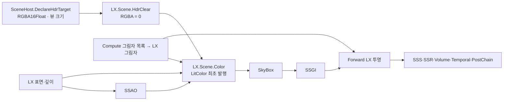

# LX HDR 최초 발행 전환 — 2026-10-12

<!-- master-doc-review:start -->
## 2026-10-20 master 구현 대조

기준: `27de3f5a02aadde7456aab680db3184c36ee735e`. 대시보드는 변경하지 않는다. 아래 현행 대조와 소스 선언이 이전 시점의 구조·미구현 표기보다 우선한다.

[전체 대조·링크 정리 원장](MasterDocumentationAudit20261020.html)

### 현행 계약과 이 문서의 적용 범위

- live material은 compiled graph 프로그램과 밀봉된 scene/view/geometry 입력을 소비한다. 준비·실패 상태에서 옛 instance를 대체 경로로 선택하는 구안을 현행 계약으로 사용하지 않는다.
- GPU scene packet·resident table·visibility/REAC 최적화는 구현 기반이다. shader의 물리 의미, route별 출력과 전체 비용의 수용은 소스 존재와 별개다.

### 해당 구현에서 확인한 선언·소유 경계

- [Editor/RenderTests/RHI/DX12/Tests/Geometry/GraphSceneFixture.h:24](https://github.com/29thnight/CreatorEngine/blob/27de3f5a02aadde7456aab680db3184c36ee735e/Editor/RenderTests/RHI/DX12/Tests/Geometry/GraphSceneFixture.h#L24) — `class GraphSceneFixture`
- [Editor/RenderTests/RHI/DX12/Tests/Geometry/GraphSceneFixture.h:27](https://github.com/29thnight/CreatorEngine/blob/27de3f5a02aadde7456aab680db3184c36ee735e/Editor/RenderTests/RHI/DX12/Tests/Geometry/GraphSceneFixture.h#L27) — `GraphSceneFixture() = default;`
- [Editor/RenderTests/RHI/DX12/Tests/Geometry/GraphSceneFixture.h:28](https://github.com/29thnight/CreatorEngine/blob/27de3f5a02aadde7456aab680db3184c36ee735e/Editor/RenderTests/RHI/DX12/Tests/Geometry/GraphSceneFixture.h#L28) — `GraphSceneFixture(const GraphSceneFixture&) = delete;`
- [Tools/build.ps1:2](https://github.com/29thnight/CreatorEngine/blob/27de3f5a02aadde7456aab680db3184c36ee735e/Tools/build.ps1#L2) — `[CmdletBinding()]`
- [Tools/build.ps1:4](https://github.com/29thnight/CreatorEngine/blob/27de3f5a02aadde7456aab680db3184c36ee735e/Tools/build.ps1#L4) — `[ValidateSet('Game')][string]$Target = 'Game',`
- [Tools/build.ps1:21](https://github.com/29thnight/CreatorEngine/blob/27de3f5a02aadde7456aab680db3184c36ee735e/Tools/build.ps1#L21) — `$repository = [IO.Path]::GetFullPath((Join-Path $PSScriptRoot '..'))`
- [Editor/RenderTests/RHI/DX12/Tests/Geometry/GraphSceneFixture.cpp:36](https://github.com/29thnight/CreatorEngine/blob/27de3f5a02aadde7456aab680db3184c36ee735e/Editor/RenderTests/RHI/DX12/Tests/Geometry/GraphSceneFixture.cpp#L36) — `bool GraphSceneFixture::Initialize(const EnhancedFrameContext& context, std::string& error, float alpha)`
- [Editor/RenderTests/RHI/DX12/Tests/Geometry/GraphSceneFixture.cpp:101](https://github.com/29thnight/CreatorEngine/blob/27de3f5a02aadde7456aab680db3184c36ee735e/Editor/RenderTests/RHI/DX12/Tests/Geometry/GraphSceneFixture.cpp#L101) — `std::uint32_t GraphSceneFixture::AddMesh(const std::vector<Vertex>& vertices,`
- [Editor/RenderTests/RHI/DX12/Tests/Geometry/GraphSceneFixture.cpp:148](https://github.com/29thnight/CreatorEngine/blob/27de3f5a02aadde7456aab680db3184c36ee735e/Editor/RenderTests/RHI/DX12/Tests/Geometry/GraphSceneFixture.cpp#L148) — `void GraphSceneFixture::CookMesh(uint32_t index)`

### 이전 근거의 유효 범위

기존 세부 계약은 위 현행 구현과 모순되지 않는 범위에서 유지한다. 과거 수치·실행 통과·해시·장치 조건은 당시 기록이다. 로컬 산출물이 사라진 항목은 링크 대신 경로와 미보존 상태를 표시하며, 현재 master의 재실행 통과로 승격하지 않는다.

<!-- master-doc-review:end -->

세부 계약·원래 분석과 당시 측정 기록

일반 `Deferred` 조명 패스를 삭제했다. 현재 렌더러는 `LX.Scene.Color` 노드에서 LX 소유 HDR 타깃을 생성·초기화하고 LX 셰이딩을 수행한다. 기존 조명 결과를 받아 보정하는 배선은 없다.

## 현재 배선

- `EnhancedDeferredPass.cpp/.h`, `Deferred.slang/.meta`와 프로젝트 등록을 삭제했다. 라이브 노드, 패스 멤버, IBL 바인딩, 가짜 Deferred 광원 한도 표시도 제거했다.
- `SceneHost::DeclareHdrTarget`가 HDR 생성과 유일한 최초 클리어를 소유한다. 빈 장면·아직 그릴 LX 머티리얼이 없는 장면도 같은 코드로 초기화한다. 호환 패스나 대체 조명 셰이더를 추가하지 않았다.
- `LX.Scene.Color`는 `LitColor`의 writer다. 굴절을 위해 공유 표면·깊이 수정 계약은 유지한다. 이후 소비자는 LX HDR을 수정한다.
- Forward 그림자 입력 설정은 Forward 노드로 옮기고 `Shadow.Map` read를 명시했다.
- 쿠킹 바이트 형식은 변경하지 않았다. 새 호환 포맷을 만들지 않았으며, 실행 검증 프로젝트에는 현재 셰이더만 복사하고 모델을 실제로 재임포트했다.

## 테스트 변경

- DX12 RenderGraph 선언 테스트는 실제 LX HDR 생성 함수를 사용한다. 최초 writer의 입력 없는 단일 쓰기, SkyBox의 이전 버전 독자와 WAR 의존성을 검사한다.
- 그림자·표면 `GraphSceneFixture`의 별도 HDR 생성 코드를 LX 소유 코드로 바꿨다.
- Raster/Matched 머티리얼 도구와 Decal·SSS·굴절·Volume `.inl`에서 Deferred 참조를 제거했다. 삭제된 표면 패스의 Initialize/Prepare API를 호출하지 않고 리소스를 선언한다. 굴절·Volume의 일반 표면 가림체는 LX 머티리얼 드로우로 옮겼다.
- 삭제된 indexed 그림자 배치에 의존하던 `csm_legacy_batch_tests.inl`과 호출·검증 입력 등록을 제거했다. 현재 에디터의 compute 목록·메시 셰이더 그림자 검증이 실행 증거다.
- ABI 검사에서 삭제된 Deferred 셰이더를 제외하고 현재 검사 수 `compiled=50 rejected=18`을 확인했다.
- 실제 캡처 검사에 Deferred 부재, LX HDR 클리어 1회, 빈 장면의 LX 출력 RGBA 정확히 0, LX 단계의 유한한 조명 픽셀을 추가했다.

## 실행 결과

| 검사 | Debug | Release |
|---|---:|---:|
| 에디터 빌드·정상 종료 | 통과 | 통과 |
| CPU meshlet 계약 | 72/72 | 72/72 |
| GPU 그림자 생존 목록 / payload 바이트 | 12 / 12 | 12 / 12 |
| RenderGraph 실행·픽셀 회귀 | 통과 | 통과 |
| 빈 장면 LX HDR RGBA 초기화 | 전부 0 | 전부 0 |
| LX 표면 깊이 / LX 조명 픽셀 | 252 / 252 | 252 / 252 |
| GPU validation 문제 / lost message | 0 / 0 | 0 / 0 |
| 실행 전후 소스·바이너리 동일 | 통과 | 통과 |

실제 에디터 캡처의 최초 LX 출력과 컴파일 그래프를 검사했다. GPU validation 실행은 성능 측정이 아니다. 별도 Raster/Matched 도구는 Release 빌드를 확인했으며, 그 도구의 특수 머티리얼 전체 GPU 행렬은 이번에 재실행하지 않았다. Vulkan 실행 수용은 계속 PHASE 4.9 범위다.

변이 검사 4건도 예상 거부를 확인했다: Deferred 노드 삽입, HDR 클리어 삭제, HDR 클리어 중복, 빈 LX HDR의 첫 값 오염. 오염 검사는 독립 복사본을 사용했고 예상 거부 후 복제 픽셀을 삭제했다.

첫 Release 실행의 초기 판정은 거부였다. 당시 검사가 SkyBox까지 합성한 최종 HDR을 검정으로 요구했기 때문이다. 원본을 보존해 LX 직후 출력은 정확히 0임을 확인했고, 검사 지점을 실제 LX 초기화 출력으로 수정했다. Debug와 Release를 수정된 검사로 다시 정상 실행해 통과했다. 최초 실패 판정은 덮어쓰지 않고 `Release-Initial/review.json`에 원인을 기록했다.

## 증거

- 최종 통합 판정 (`../../Build/Verification/LxHdrCutover-20261012/final-verdict.json` — 로컬 실행 산출물 미보존; 당시 기록으로만 참조)
- 현재 소스 계약 (`../../Build/Verification/LxHdrCutover-20261012/source-audit.json` — 로컬 실행 산출물 미보존; 당시 기록으로만 참조)
- 변경 파일 SHA (`../../Build/Verification/LxHdrCutover-20261012/scope-manifest.json` — 로컬 실행 산출물 미보존; 당시 기록으로만 참조)
- Debug 실행 (`../../Build/Verification/LxHdrCutover-20261012/Debug-Accepted/verdict.json` — 로컬 실행 산출물 미보존; 당시 기록으로만 참조)
- Release 실행 (`../../Build/Verification/LxHdrCutover-20261012/Release-Accepted/verdict.json` — 로컬 실행 산출물 미보존; 당시 기록으로만 참조)
- 변이 검사 (`../../Build/Verification/LxHdrCutover-20261012/oracle-mutations.json` — 로컬 실행 산출물 미보존; 당시 기록으로만 참조)
- 초기 검사 실패 검토 (`../../Build/Verification/LxHdrCutover-20261012/Release-Initial/review.json` — 로컬 실행 산출물 미보존; 당시 기록으로만 참조)

최신 성공의 Debug/Release 빈 장면·표면 원본은 보존한다. 이전 실패 원본과 로그도 검토 근거로 보존한다. 이 전환은 메시별 변환 패스 배치화나 GPU culling/LOD 구조를 변경하지 않는다.

