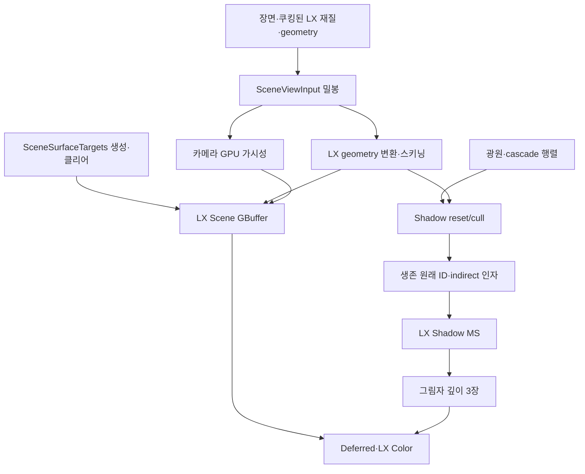

# LX Scene 단일 배선 전환 — 2026-10-12

<!-- master-doc-review:start -->
## 2026-10-20 master 구현 대조

기준: `27de3f5a02aadde7456aab680db3184c36ee735e`. 대시보드는 변경하지 않는다. 아래 현행 대조와 소스 선언이 이전 시점의 구조·미구현 표기보다 우선한다.

[전체 대조·링크 정리 원장](MasterDocumentationAudit20261020.html)

### 현행 계약과 이 문서의 적용 범위

- live material은 compiled graph 프로그램과 밀봉된 scene/view/geometry 입력을 소비한다. 준비·실패 상태에서 옛 instance를 대체 경로로 선택하는 구안을 현행 계약으로 사용하지 않는다.
- GPU scene packet·resident table·visibility/REAC 최적화는 구현 기반이다. shader의 물리 의미, route별 출력과 전체 비용의 수용은 소스 존재와 별개다.

### 해당 구현에서 확인한 선언·소유 경계

- [Engine/RenderEngine/ShaderMeta.h:24](https://github.com/29thnight/CreatorEngine/blob/27de3f5a02aadde7456aab680db3184c36ee735e/Engine/RenderEngine/ShaderMeta.h#L24) — `enum class ShaderPropertyType : std::uint8_t`
- [Engine/RenderEngine/ShaderMeta.h:98](https://github.com/29thnight/CreatorEngine/blob/27de3f5a02aadde7456aab680db3184c36ee735e/Engine/RenderEngine/ShaderMeta.h#L98) — `enum class ShaderPassQueue : std::uint8_t`
- [Engine/RenderEngine/ShaderMeta.h:106](https://github.com/29thnight/CreatorEngine/blob/27de3f5a02aadde7456aab680db3184c36ee735e/Engine/RenderEngine/ShaderMeta.h#L106) — `enum class ShaderBlendMode : std::uint8_t`
- [Editor/RenderTests/RHI/DX12/Tests/Geometry/GraphSceneFixture.h:24](https://github.com/29thnight/CreatorEngine/blob/27de3f5a02aadde7456aab680db3184c36ee735e/Editor/RenderTests/RHI/DX12/Tests/Geometry/GraphSceneFixture.h#L24) — `class GraphSceneFixture`
- [Editor/RenderTests/RHI/DX12/Tests/Geometry/GraphSceneFixture.h:27](https://github.com/29thnight/CreatorEngine/blob/27de3f5a02aadde7456aab680db3184c36ee735e/Editor/RenderTests/RHI/DX12/Tests/Geometry/GraphSceneFixture.h#L27) — `GraphSceneFixture() = default;`
- [Editor/RenderTests/RHI/DX12/Tests/Geometry/GraphSceneFixture.h:28](https://github.com/29thnight/CreatorEngine/blob/27de3f5a02aadde7456aab680db3184c36ee735e/Editor/RenderTests/RHI/DX12/Tests/Geometry/GraphSceneFixture.h#L28) — `GraphSceneFixture(const GraphSceneFixture&) = delete;`
- [Engine/RenderEngine/Render/Passes/Geometry/SceneSurfaceTargets.h:7](https://github.com/29thnight/CreatorEngine/blob/27de3f5a02aadde7456aab680db3184c36ee735e/Engine/RenderEngine/Render/Passes/Geometry/SceneSurfaceTargets.h#L7) — `class SceneSurfaceTargets final`
- [Engine/RenderEngine/Render/Passes/Geometry/SceneSurfaceTargets.h:9](https://github.com/29thnight/CreatorEngine/blob/27de3f5a02aadde7456aab680db3184c36ee735e/Engine/RenderEngine/Render/Passes/Geometry/SceneSurfaceTargets.h#L9) — `public:`
- [Engine/RenderEngine/Render/Passes/Geometry/SceneSurfaceTargets.h:12](https://github.com/29thnight/CreatorEngine/blob/27de3f5a02aadde7456aab680db3184c36ee735e/Engine/RenderEngine/Render/Passes/Geometry/SceneSurfaceTargets.h#L12) — `struct Outputs {`
- [Tools/build.ps1:2](https://github.com/29thnight/CreatorEngine/blob/27de3f5a02aadde7456aab680db3184c36ee735e/Tools/build.ps1#L2) — `[CmdletBinding()]`
- [Tools/build.ps1:4](https://github.com/29thnight/CreatorEngine/blob/27de3f5a02aadde7456aab680db3184c36ee735e/Tools/build.ps1#L4) — `[ValidateSet('Game')][string]$Target = 'Game',`
- [Tools/build.ps1:21](https://github.com/29thnight/CreatorEngine/blob/27de3f5a02aadde7456aab680db3184c36ee735e/Tools/build.ps1#L21) — `$repository = [IO.Path]::GetFullPath((Join-Path $PSScriptRoot '..'))`
- [Engine/RenderEngine/ShaderMeta.cpp:28](https://github.com/29thnight/CreatorEngine/blob/27de3f5a02aadde7456aab680db3184c36ee735e/Engine/RenderEngine/ShaderMeta.cpp#L28) — `outError = std::string(context) + ": " + std::string(detail);`
- [Engine/RenderEngine/ShaderMeta.cpp:65](https://github.com/29thnight/CreatorEngine/blob/27de3f5a02aadde7456aab680db3184c36ee735e/Engine/RenderEngine/ShaderMeta.cpp#L65) — `const bool known = std::any_of(allowed.begin(), allowed.end(),`
- [Engine/RenderEngine/ShaderMeta.cpp:102](https://github.com/29thnight/CreatorEngine/blob/27de3f5a02aadde7456aab680db3184c36ee735e/Engine/RenderEngine/ShaderMeta.cpp#L102) — `else return Fail(context, std::string("'") + key + "'는 true|false여야 한다", outError);`
- [Editor/RenderTests/RHI/DX12/Tests/Geometry/GraphSceneFixture.cpp:36](https://github.com/29thnight/CreatorEngine/blob/27de3f5a02aadde7456aab680db3184c36ee735e/Editor/RenderTests/RHI/DX12/Tests/Geometry/GraphSceneFixture.cpp#L36) — `bool GraphSceneFixture::Initialize(const EnhancedFrameContext& context, std::string& error, float alpha)`
- [Editor/RenderTests/RHI/DX12/Tests/Geometry/GraphSceneFixture.cpp:101](https://github.com/29thnight/CreatorEngine/blob/27de3f5a02aadde7456aab680db3184c36ee735e/Editor/RenderTests/RHI/DX12/Tests/Geometry/GraphSceneFixture.cpp#L101) — `std::uint32_t GraphSceneFixture::AddMesh(const std::vector<Vertex>& vertices,`
- [Editor/RenderTests/RHI/DX12/Tests/Geometry/GraphSceneFixture.cpp:148](https://github.com/29thnight/CreatorEngine/blob/27de3f5a02aadde7456aab680db3184c36ee735e/Editor/RenderTests/RHI/DX12/Tests/Geometry/GraphSceneFixture.cpp#L148) — `void GraphSceneFixture::CookMesh(uint32_t index)`
- [Engine/RenderEngine/Render/Passes/Geometry/SceneSurfaceTargets.cpp:4](https://github.com/29thnight/CreatorEngine/blob/27de3f5a02aadde7456aab680db3184c36ee735e/Engine/RenderEngine/Render/Passes/Geometry/SceneSurfaceTargets.cpp#L4) — `RHIFormat SceneSurfaceTargets::GetRenderTargetFormat(uint32_t index)`
- [Engine/RenderEngine/Render/Passes/Geometry/SceneSurfaceTargets.cpp:9](https://github.com/29thnight/CreatorEngine/blob/27de3f5a02aadde7456aab680db3184c36ee735e/Engine/RenderEngine/Render/Passes/Geometry/SceneSurfaceTargets.cpp#L9) — `void SceneSurfaceTargets::Declare(EnhancedRenderGraph& graph, const EnhancedFrameContext& context)`
- [Engine/RenderEngine/Render/Passes/Geometry/SceneSurfaceTargets.cpp:15](https://github.com/29thnight/CreatorEngine/blob/27de3f5a02aadde7456aab680db3184c36ee735e/Engine/RenderEngine/Render/Passes/Geometry/SceneSurfaceTargets.cpp#L15) — `void SceneSurfaceTargets::DeclareVisibility(EnhancedRenderGraph& graph, const EnhancedFrameContext& context)`

### 이전 근거의 유효 범위

기존 세부 계약은 위 현행 구현과 모순되지 않는 범위에서 유지한다. 과거 수치·실행 통과·해시·장치 조건은 당시 기록이다. 로컬 산출물이 사라진 항목은 링크 대신 경로와 미보존 상태를 표시하며, 현재 master의 재실행 통과로 승격하지 않는다.

<!-- master-doc-review:end -->

세부 계약·원래 분석과 당시 측정 기록

> HDR 후속 전환: [LX HDR 최초 발행 전환](LxHdrCutover20261012.md). 일반 Deferred 패스·셰이더를 삭제하고 HDR 생성·초기화를 LX로 옮겼다.

사용자 지시: 일반 GBuffer 표면 구현과 관련 구경로 테스트를 제거한다. 신규 LX 배선만 사용하며 old/new A/B는 사용자가 수행한다. 호환 변환·구경로 폴백을 만들지 않고 필요한 리소스는 강제 리임포트·재쿠킹한다.

메시렛 데이터 계약 후속에서는 [Scene ABI 22·CEMC 13과 단일 쿠킹 topology](LxMeshletGeometryContract20261012.md)로 갱신했다. 아래 ABI 21·CEMC 12 및 실행 결과는 일반 GBuffer 제거 시점의 기록이다.

## 실제 제거와 새 책임

- `EnhancedGBufferPass.cpp/.h` 전체 삭제. 배치·ShaderMeta PSO·일반 표면 기록·일반 컬링 코드는 타깃 생성 코드에 남기지 않았다.
- `GpuMeshletVisibility.cpp/.h`, `GeometryMeshletVisibility.slang`, `GBuffer.slang`, `GBuffer.shadermeta` 삭제 및 프로젝트 등록 제거.
- `SceneSurfaceTargets`는 MRT5·깊이 생성과 클리어만 담당한다. geometry·material·PSO·culling·draw·호환 API가 없는 리소스 계약이다. 실제 표면 기록은 LX SceneHost가 소유한다.
- `CREATOR_LX_MESHLETS`, `CREATOR_LX_SHADOW_MESHLET_COMPUTE`, `allowMeshlets`와 Temporal fixture 표면 경로 선택을 제거했다. 불투명 LX 표면과 그림자는 지원되는 meshlet indirect 배선을 요구한다. 투명·Temporal 전용 LX 소비자는 해당 기능의 GPU 배선을 사용한다.
- 그림자는 compute 생존 목록만 소비한다. 기존 그림자 인스턴스 가시성 버퍼·패스와 전체 메시렛/indexed 대체 dispatch를 제거했다.
- Scene ABI는 21. 이전 Scene ABI 제품은 검증기와 SceneHost가 거부하며 런타임 Scene 재컴파일·변환 경로도 삭제했다. authoring Scene cache의 ABI 불일치는 새 제품 생성으로 이어지고, Player는 새 제품 재쿠킹이 필요하다.

모델 쿠킹 형식은 CEMC 12로 올렸다. 기존 GBuffer/Forward ShaderMeta 참조를 제거하고 같은 임포트 트랜잭션이 발행하는 실제 LX 재질 그래프 ID를 기록한다. 이전 캐시는 강제 리임포트·재쿠킹 대상이다.

## 테스트 변경

일반 GBuffer를 실행하던 `RunGBufferTest`, `RunSceneBindingTest`, Vulkan geometry/PBR shader parity 및 구 IBL shade 테스트 본문과 등록을 제거했다. 성공을 반환하는 대체 함수를 두지 않았다. 해당 일반 경로에 의존한 Vulkan forward/deferred/decal/SSAO/SSGI 테스트도 함께 퇴역했다. Vulkan 신규 배선 검증은 PHASE 4.9에 남는다.

필요한 스키닝·그림자 검사는 `GraphSceneFixture`가 실제 LX SceneHost의 seal/prepare/declare/publish를 실행하도록 변경했다. 구 일반 카메라 표면은 사용하지 않는다. GPU 인자·ID·변환 정점 리드백에 대한 CPU clip oracle와 ID 범위·중복·필수 항목 누락 검사는 유지한다. 포즈 변화·정적 형상 유지 검사는 신규 경로의 기능 검사다. 구 Deferred 색상 및 A/B 계약에 의존하던 EnhancedShadowQualityTest는 본문·명령·프로젝트 등록까지 제거했다. 그림자 검증은 LX compute 목록·간접 인자·변환 정점·깊이 기록 검사로 유지한다.

구경로 A/B 스크립트 7개와 indexed/meshlet 깊이 맵 동치 실행 본문을 제거했다. 삭제된 일반 GBuffer 명령을 호출하던 FT primitives·model scene consumption·PBR wiring 스크립트도 퇴역했다. 이들의 전체 과거 시나리오를 새 검사에서 재현했다고 주장하지 않는다. 명령 목록 검사는 LX skinning/rendergraph 등록을 요구하도록 변경했고, geometry identity 검사는 LX 밀봉 geometryKey 소비를 확인한다. 새 `verify-lx-scene-cutover.ps1`와 `verify-lx-scene-capture.py`는 LX 스키닝·그림자·그래프·실제 표시·유한한 비어 있지 않은 깊이/HDR 픽셀 및 GPU validation을 검사한다. 이전 원본 로그·판정·프로파일은 역사적 자료로 보존한다.

## 현재 배선

## 검증 상태

Release·Debug 빌드 통과. 최종 판정은 `Build/Verification/SceneSurfaceCutover-20261012`에 기록했다.

| 구성 | LX GPU 목록 검사 | 실제 Scene 캡처 | 깊이/HDR 픽셀 | GPU validation |
|---|---:|---|---:|---:|
| Release | 144건, 필수 누락 0 | frame 1021, mesh shader indirect 1건 | 252/252 | 문제 0 |
| Debug | 12건, 필수 누락 0 | frame 932, mesh shader indirect 1건 | 252/252 | 문제 0 |

두 실행 모두 LX 스키닝·rendergraph·모델 강제 리임포트/로드/배치·캡처·정상 종료를 통과했고 실행 중 소스/바이너리 신원이 일치했다. 캡처의 command recording은 `LX.Scene.GBuffer`, meshShader=true, indirect=true다. 픽셀 oracle는 두 결과에 별도로 실행해 통과했고 최종 검증 스크립트에도 연결했다. 픽셀 oracle 통합 후 Release 라이브 검증도 다시 실행해 통과했다(`Release-Integrated`, frame 1037, 깊이/HDR 252/252, mesh indirect 1, validation 0). 명령 목록에서 퇴역 명령 17개가 제거된 것을 실제 실행으로 확인했다. 정적 신원 검사와 문서 구조/링크 검사도 통과했다.

실패한 중간 실행도 보존했다. 캡처의 게임/에디터 대상 오류와 LX 프로그램 준비 전 캡처를 수정했으며, CPU 프레임 대기는 예열일 뿐 합격 근거는 GPU 캡처와 리드백이다. GPU 기반 validation의 초기 준비 시간은 성능 판정으로 사용하지 않는다. old/new A/B는 사용자 몫이며 Vulkan 실행 검증은 PHASE 4.9에 남는다.

변경 전 소스는 해당 디렉터리의 `Before`에 보존했다. 이는 삭제한 활성 구현의 복구용 기록이며 프로젝트·런타임 배선에 등록하지 않는다. 작업 전부터 존재한 다른 변경은 유지한다.

