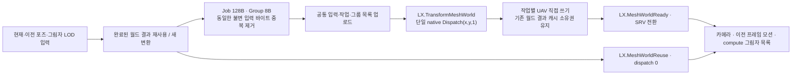

# LX 메시 변환 단일 dispatch 전환 — 2026-10-12

메시별 `Dispatch` 루프를 제거했다. 현재 LX 메시 변환은 한 뷰의 새 변환 작업을 모아 공통 커널을 **한 번** 호출한다. GPU가 각 메시 출력 UAV에 직접 쓰며 중간 결과 재복사나 기존 셰이더 전환 경로는 없다.

## 배선과 계약

- CPU는 작업마다 world 행렬, vertex stride/속성 offsets, 포즈·LOD·입력 주소를 봉인한다. 같은 불변 vertex/LOD/포즈 바이트는 목록 안에서 재사용한다.
- 그룹 하나가 한 작업의 최대 32개 vertex를 처리한다. GPU는 Group에서 Job을 찾고, 작업별 UAV를 선택한다. 마지막 부분 그룹과 2D dispatch의 여분 그룹을 bounds 검사한다.
- 모든 출력은 기존 메시별 버퍼다. 소비자와 완료된 결과 캐시의 핸들·소유권을 바꾸지 않고, 공통 커널이 직접 각 버퍼에 쓴다. 결과 scatter copy는 0회다.
- 즉시 단일 메시 평가도 같은 작업 목록 커널을 사용한다. 별도 단일 메시 셰이더나 호환 분기는 없다.
- 새 작업 한도는 4096개, packed input 한도는 256 MiB다. 넘으면 명시적으로 실패한다. dispatch 차원은 각 축 65535 이하이며 큰 목록도 한 번의 2D dispatch로 실행한다.
- `GetComputeDispatchCount`는 DX12/Vulkan의 실제 native 호출 위치에서 증가한다. 변환 기록은 호출 전후 차이가 정확히 1인지 검사한다. 실제 실행 수용은 DX12만 수행했고 Vulkan은 PHASE 4.9 범위다.
- geometry/meshlet 쿠킹 바이트 ABI는 바뀌지 않았다. 변환 helper 셰이더와 바인딩 계약은 변경됐으므로 배포 셰이더·검증 캐시는 현재 소스로 다시 쿠킹해야 한다. 구형 helper 인자를 받는 경로를 추가하지 않았다. 실제 검증 프로젝트는 현재 셰이더를 복사하고 모델을 강제 재임포트했다.

## 실행 정확도

Debug/Release의 현재 소스·바이너리로 CPU meshlet 계약 72/72, GPU 그림자 목록 12건·payload byte 비교 12건, 기존 스키닝·RenderGraph 실행·픽셀 회귀를 통과했다. 에디터 빈 LX HDR은 전부 0, 실제 메시 깊이·LX 조명 픽셀은 각 252개였다. GPU validation 문제·dropped message는 모두 0, 정상 quit·exit 0, 실행 전후 identity 동일을 확인했다.

새 GPU 변환 검사는 다음을 각각 실제 버퍼 readback으로 확인했다. actor 수 추정이나 단순 패스 이름 검색으로 dispatch 수를 판정하지 않았다.

| 새 작업 | 포인트 | 변환 패스 | 준비 패스 | native dispatch | 내용 |
|---:|---:|---:|---:|---:|---|
| 1 | 33 | 1 | 1 | 1 | 단일 정적 작업 · 부분 그룹 |
| 16 | 528 | 1 | 1 | 1 | 정적·스키닝 혼합 |
| 64 | 2,112 | 1 | 1 | 1 | 정적·스키닝 혼합 |
| 256 | 8,448 | 1 | 1 | 1 | 정적·스키닝 혼합 |
| 512 | 16,896 | 1 | 1 | 1 | 정적·스키닝 혼합 |
| 512 | 2,096,640 | 1 | 1 | 1 | 65,536 그룹 → Dispatch(32768, 2, 1) |

각 작업의 서로 다른 world·bone 이동·LOD를 사용해 CPU의 독립적인 위치·UV·LOD·프레임 기준값과 전 포인트를 비교했다. 위치 오차 한도 1e-4, 프레임 축 오차 한도 1e-6이다. 비균일 world scale에서 tangent/bitangent는 길이 비율을 유지하며 normal만 정규화하는 기존 SurfacePoint 계약을 기준으로 삼았다.

## 다수 메시 최초 변환 성능

Release, RTX 2080 Ti / driver 595.97, GPU validation off, 실제 에디터 normal native-real 프레임이다. helper PSO와 정적 소스만 seed로 예열한 뒤 한 명령 안에서 새 인스턴스를 만들었다. 그 인스턴스들의 월드 결과는 처음 변환된다. 한 장면의 연속 프레임을 독립 반복으로 셈하지 않고, 크기별 독립 프로세스 4회를 사용했다.

카메라 LOD와 그림자 LOD0가 별도 결과를 요구해 이 장면에서는 인스턴스마다 변환 작업이 2개였다. 원시 native 영수증의 realFrameId/viewId를 최종 `.ceprof` GPU 측정과 정확히 결합했다. 각 첫 변환에서 변환·준비 패스는 1개씩이며 native dispatch는 1회였다.

| 새 인스턴스 | 새 작업 | 변환 포인트 | 변환 / 준비 / dispatch | 변환 패스 GPU 평균 ms | 독립 반복 CV | 첫 뷰 전체 CPU 기록·제출 평균 ms |
|---:|---:|---:|---|---:|---:|---:|
| 16 | 32 | 31,312 | 1 / 1 / 1 | 0.0752 | 17.55% | 14.55 |
| 64 | 128 | 125,248 | 1 / 1 / 1 | 1.8412 | 3.82% | 39.86 |
| 256 | 512 | 500,992 | 1 / 1 / 1 | 5.5667 | 22.24% | 150.49 |
| 512 | 1024 | 1,001,984 | 1 / 1 / 1 | 5.6643 | 12.38% | 291.87 |

CPU 열은 전체 뷰의 준비·기록·제출 범위다. 작업 목록 업로드만의 비용, GPU 시간, 표시 FPS 또는 입력 지연으로 읽으면 안 된다. GPU 패스 시간도 전이·기록된 pass 구간이며 다른 GPU 패스의 합은 queue wall time이 아니다.

**패스·native dispatch 수와 기록 provenance는 통과했지만 성능 개선은 수용하지 않는다.** 16·256·512 구간은 GPU 독립 반복 CV 10% 기준을 넘었다. 64 구간만 CV 기준을 통과했다. 최초 변환 전후 NVML telemetry에는 P8/P5, graphics 450–630 MHz, memory 405/810 MHz 상태가 기록됐고 정책을 고정하지 않았다. 약 100 ms 간격의 telemetry는 커널 안의 정확한 순간 클럭을 증명하지 않는다. 과거 P0 측정이나 묶기 전 17.79ms와 직접 배율 비교하지 않는다. 사용자 소유 A:B 비교 경로를 구현하지 않았다.

이 측정 당시 완료 결과 캐시의 256-entry/32-MiB 한도 때문에 큰 장면은 예열 뒤에도 변환이 반복될 수 있었다. 후속 [활성 장면 수명 전환](LxTransformResidency20261012.md)에서 이 한도를 활성 결과의 퇴출 조건에서 제거하고 실제 512개 장면의 예열 후 변환 0회를 검증했다. 위 측정 값은 당시 소스의 기록으로 유지하며 후속 코드의 성능 값으로 재판정하지 않는다. GPU culling/LOD·다른 패스의 dispatch 수는 이번 변환 통합에서 변경하지 않았다. 계산량과 출력 메모리는 vertex 수에 비례하며 전체 cold CPU 비용은 별도 분석 대상이다.

## 실패 검토와 보존

- 첫 정확도 실행은 독립 oracle가 tangent/bitangent를 단위 길이로 가정해 거부됐다. 기존 비균일 scale 운반 계약에 맞게 기준을 고쳤고, kernel 수학은 바꾸지 않았다. 수정 후 Debug/Release 전 포인트 검사와 2D 경계를 통과했다.
- 첫 측정 도구 smoke는 commandlet 전용 shorthand를 HTTP에 사용해 거부됐다. 등록된 `render.live.fence`와 실제 seed 재사용 확인으로 수정했다.
- 512 반복 한 건의 `.ceprof`는 `complete=false`라 제외했다. 원본의 `Capture.Incomplete.Gpu: GPU drain deadline expired`를 보존했다. timeout이나 판정 기준을 늘리지 않았다.
- offscreen host에는 닫을 수 있는 Scene 창이 없어 UI 종료 시도는 거부됐고, 비동기 scene restore를 기다리지 않은 시도도 제외했다. 최종 절차는 측정 구간 뒤에 장면을 저장하고 empty scene의 더 새 epoch가 GPU에서 완료됐음을 확인한 후 recorder를 종료한다. scene load Ready를 기다려 복원·픽셀 캡처하고 정상 quit한다. 최초 변환 표본은 epoch 변경 이전의 exact key로 선택한다.
- 최종 512 반복 4건은 이 완료 절차로 통과했다. 이전 16/64/256의 정상 반복 12건과 runtime SHA가 동일하다. 선택한 최종 표본은 총 16건이며 실패/탐색 표본을 평균에 섞지 않았다.

원시 GPU 시간, CV, native receipts, power CSV, source/runtime SHA, `.ceprof`, 로그·판정을 보존한다. 성공 raw pixels는 구성·장면 크기별 최신 대표 1건을 유지했다. 이전 정상 반복의 픽셀은 retention ledger와 판정을 남기고 제거했으므로 그 픽셀 replay는 불가능하다. 실패 원본과 검토는 보존한다.

## 증거와 재현

- [소스 계약](../../Build/Verification/LxTransformDispatch-20261012/source-audit.json)
- [변경 SHA](../../Build/Verification/LxTransformDispatch-20261012/scope-manifest.json)
- [Debug 변환 판정](../../Build/Verification/LxTransformDispatch-20261012/Debug-Accepted/transform-verdict.json)
- [Release 변환 판정](../../Build/Verification/LxTransformDispatch-20261012/Release-Accepted/transform-verdict.json)
- [성능 원시 값·통합 판정](../../Build/Verification/LxTransformDispatch-20261012/performance-verdict.json)
- [현재 GPU gate](../../Tools/regression/verify-lx-transform-dispatch.ps1)
- [측정 도구](../../Tools/regression/measure-lx-transform-dispatch.ps1)
- [exact-frame 분석](../../Tools/regression/verify-lx-transform-performance.py)

GPU gate는 `-Configuration Debug|Release -FixtureProject <source> -OutputDirectory <fresh-directory>`로 실행한다. 성능 도구는 `-Counts 16,64,256,512 -Iterations 4`로 실행한 뒤 분석 도구를 같은 디렉터리에 실행한다. 실패를 검토하고 모든 oracle·정상 종료가 통과한 후에만 ArtifactRetention 완료 정책을 적용한다.
