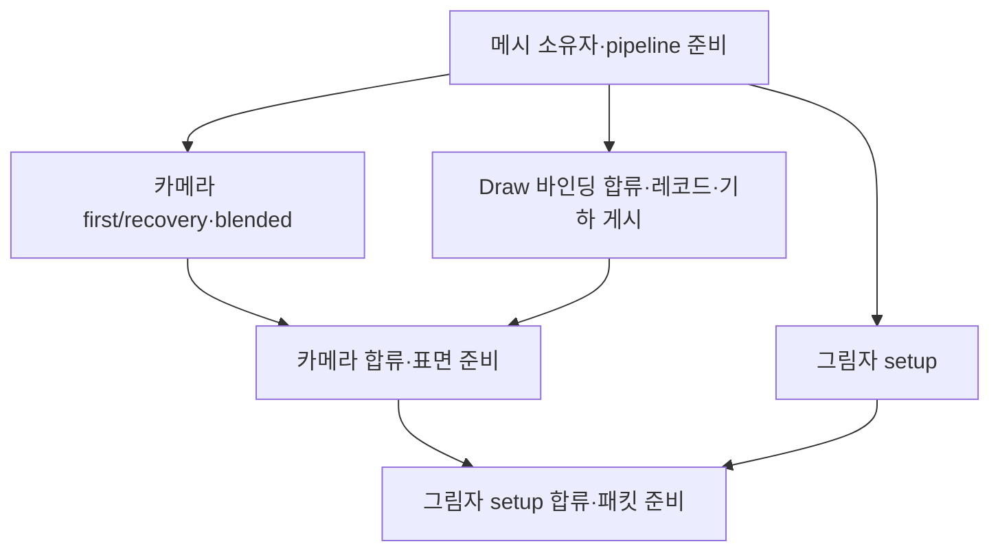

# MaterialGraphScenePrepare: 가시성 작업의 시작 시점과 반복 CPU 비용

<!-- master-doc-review:start -->
## 2026-10-20 master 구현 대조

기준: `27de3f5a02aadde7456aab680db3184c36ee735e`. 대시보드는 변경하지 않는다. 아래 현행 대조와 소스 선언이 이전 시점의 구조·미구현 표기보다 우선한다.

[전체 대조·링크 정리 원장](MasterDocumentationAudit20261020.html)

### 현행 계약과 이 문서의 적용 범위

- live material은 compiled graph 프로그램과 밀봉된 scene/view/geometry 입력을 소비한다. 준비·실패 상태에서 옛 instance를 대체 경로로 선택하는 구안을 현행 계약으로 사용하지 않는다.
- GPU scene packet·resident table·visibility/REAC 최적화는 구현 기반이다. shader의 물리 의미, route별 출력과 전체 비용의 수용은 소스 존재와 별개다.

### 해당 구현에서 확인한 선언·소유 경계

- [Engine/RenderEngine/MaterialGraphSceneGpuData.h:84](https://github.com/29thnight/CreatorEngine/blob/27de3f5a02aadde7456aab680db3184c36ee735e/Engine/RenderEngine/MaterialGraphSceneGpuData.h#L84) — `bool AssignGeometry(uint32_t record, const std::shared_ptr<const MeshSurfaceBatch>& current,`
- [Engine/RenderEngine/MaterialGraphSceneGpuData.h:170](https://github.com/29thnight/CreatorEngine/blob/27de3f5a02aadde7456aab680db3184c36ee735e/Engine/RenderEngine/MaterialGraphSceneGpuData.h#L170) — `bool PrepareBindings(IRenderDeviceServices& device, std::string& error)`
- [Engine/RenderEngine/MaterialGraphSceneGpuData.h:200](https://github.com/29thnight/CreatorEngine/blob/27de3f5a02aadde7456aab680db3184c36ee735e/Engine/RenderEngine/MaterialGraphSceneGpuData.h#L200) — `cache.Prepare({sceneEpoch, viewId, 2}, materialBytes, 16, "METEOR.Scene.Materials", materialBuffer, error);`
- [Engine/RenderEngine/MaterialGraphPreparationTasks.h:52](https://github.com/29thnight/CreatorEngine/blob/27de3f5a02aadde7456aab680db3184c36ee735e/Engine/RenderEngine/MaterialGraphPreparationTasks.h#L52) — `throw std::runtime_error(failure.empty() ? "Scene preparation task failed." : failure);`
- [Engine/RenderEngine/MaterialGraphPreparationTasks.h:63](https://github.com/29thnight/CreatorEngine/blob/27de3f5a02aadde7456aab680db3184c36ee735e/Engine/RenderEngine/MaterialGraphPreparationTasks.h#L63) — `throw std::runtime_error("Scene preparation task admission limit exceeded.");`
- [Engine/RenderEngine/MaterialGraphPreparationTasks.h:69](https://github.com/29thnight/CreatorEngine/blob/27de3f5a02aadde7456aab680db3184c36ee735e/Engine/RenderEngine/MaterialGraphPreparationTasks.h#L69) — `slot = scheduler_.submit_indexed(1, [execute = std::move(execute)](std::size_t) mutable`
- [Engine/Utility_Framework/ThreadPool.cpp:37](https://github.com/29thnight/CreatorEngine/blob/27de3f5a02aadde7456aab680db3184c36ee735e/Engine/Utility_Framework/ThreadPool.cpp#L37) — `std::swprintf(name, std::size(name), L"Creator.JobWorker.%u", threadnum - kExternalThreads);`
- [Engine/Utility_Framework/ThreadPool.cpp:76](https://github.com/29thnight/CreatorEngine/blob/27de3f5a02aadde7456aab680db3184c36ee735e/Engine/Utility_Framework/ThreadPool.cpp#L76) — `const bool previous = std::exchange(executing_pool_work, true);`
- [Engine/Utility_Framework/ThreadPool.cpp:77](https://github.com/29thnight/CreatorEngine/blob/27de3f5a02aadde7456aab680db3184c36ee735e/Engine/Utility_Framework/ThreadPool.cpp#L77) — `enki::ICompletable::OnDependenciesComplete(scheduler, thread);`
- [Engine/Utility_Framework/JobScheduler.cpp:19](https://github.com/29thnight/CreatorEngine/blob/27de3f5a02aadde7456aab680db3184c36ee735e/Engine/Utility_Framework/JobScheduler.cpp#L19) — `notifications.push_back({std::move(callback), error});`
- [Engine/Utility_Framework/JobScheduler.cpp:28](https://github.com/29thnight/CreatorEngine/blob/27de3f5a02aadde7456aab680db3184c36ee735e/Engine/Utility_Framework/JobScheduler.cpp#L28) — `auto next = std::move(notifications.back());`
- [Engine/Utility_Framework/JobScheduler.cpp:39](https://github.com/29thnight/CreatorEngine/blob/27de3f5a02aadde7456aab680db3184c36ee735e/Engine/Utility_Framework/JobScheduler.cpp#L39) — `std::chrono::duration_cast<std::chrono::nanoseconds>(std::chrono::steady_clock::now().time_since_epoch())`
- [Engine/RenderEngine/GpuGeometryVisibility.cpp:603](https://github.com/29thnight/CreatorEngine/blob/27de3f5a02aadde7456aab680db3184c36ee735e/Engine/RenderEngine/GpuGeometryVisibility.cpp#L603) — `bool GpuGeometryVisibility::PrepareMeshlets(`
- [Engine/RenderEngine/GpuGeometryVisibility.cpp:719](https://github.com/29thnight/CreatorEngine/blob/27de3f5a02aadde7456aab680db3184c36ee735e/Engine/RenderEngine/GpuGeometryVisibility.cpp#L719) — `if (!PrepareInternal(context, projection, candidates, bins, result, error,`
- [Engine/RenderEngine/GpuGeometryVisibility.cpp:915](https://github.com/29thnight/CreatorEngine/blob/27de3f5a02aadde7456aab680db3184c36ee735e/Engine/RenderEngine/GpuGeometryVisibility.cpp#L915) — `bool GpuGeometryVisibility::PrepareInternal(`
- [Engine/RenderEngine/MaterialGraphSceneHost.cpp:1614](https://github.com/29thnight/CreatorEngine/blob/27de3f5a02aadde7456aab680db3184c36ee735e/Engine/RenderEngine/MaterialGraphSceneHost.cpp#L1614) — `bool SceneHost::PrepareProgram(const EnhancedFrameContext&, const Instance& instance,`
- [Engine/RenderEngine/MaterialGraphSceneHost.cpp:1782](https://github.com/29thnight/CreatorEngine/blob/27de3f5a02aadde7456aab680db3184c36ee735e/Engine/RenderEngine/MaterialGraphSceneHost.cpp#L1782) — `bool SceneHost::PrepareResidency(const EnhancedFrameContext& context,`
- [Engine/RenderEngine/MaterialGraphSceneHost.cpp:1813](https://github.com/29thnight/CreatorEngine/blob/27de3f5a02aadde7456aab680db3184c36ee735e/Engine/RenderEngine/MaterialGraphSceneHost.cpp#L1813) — `bool SceneHost::Prepare(const EnhancedFrameContext& context, own::shared_owner<const SceneViewInput> input,`
- [Tools/regression/verify-scene-geometry-pages.py:13](https://github.com/29thnight/CreatorEngine/blob/27de3f5a02aadde7456aab680db3184c36ee735e/Tools/regression/verify-scene-geometry-pages.py#L13) — `SOURCE = Path('Engine/RenderEngine/MaterialGraphSceneGpuData.h')`
- [Tools/regression/verify-scene-geometry-pages.py:49](https://github.com/29thnight/CreatorEngine/blob/27de3f5a02aadde7456aab680db3184c36ee735e/Tools/regression/verify-scene-geometry-pages.py#L49) — `method, line = block(source, 'bool AssignGeometry(')`
- [Tools/regression/verify-scene-geometry-pages.py:50](https://github.com/29thnight/CreatorEngine/blob/27de3f5a02aadde7456aab680db3184c36ee735e/Tools/regression/verify-scene-geometry-pages.py#L50) — `bindings, binding_line = block(source, 'bool PrepareBindings(')`
- [Tools/regression/verify-scene-cpu-preparation.py:100](https://github.com/29thnight/CreatorEngine/blob/27de3f5a02aadde7456aab680db3184c36ee735e/Tools/regression/verify-scene-cpu-preparation.py#L100) — `definitions += emit(baseline, baseline_path, 'struct SceneCpuPreparation final', True) + '}\n'`
- [Tools/regression/verify-scene-cpu-preparation.py:102](https://github.com/29thnight/CreatorEngine/blob/27de3f5a02aadde7456aab680db3184c36ee735e/Tools/regression/verify-scene-cpu-preparation.py#L102) — `'struct PreparationScratch; };\n')`
- [Tools/regression/verify-scene-cpu-preparation.py:103](https://github.com/29thnight/CreatorEngine/blob/27de3f5a02aadde7456aab680db3184c36ee735e/Tools/regression/verify-scene-cpu-preparation.py#L103) — `definitions += emit(source, root / HOST, 'struct SceneCpuPreparation final', True)`

### 이전 근거의 유효 범위

기존 세부 계약은 위 현행 구현과 모순되지 않는 범위에서 유지한다. 과거 수치·실행 통과·해시·장치 조건은 당시 기록이다. 로컬 산출물이 사라진 항목은 링크 대신 경로와 미보존 상태를 표시하며, 현재 master의 재실행 통과로 승격하지 않는다.

<!-- master-doc-review:end -->

<details data-master-history><summary>세부 계약·원래 분석과 당시 측정 기록</summary>

기준 커밋: `001ff417b7745401622f4f9ab8e8b9b15fb9ab4d` (`master`, 2026-10-19).
앞선 RenderGraphDeclare PR #184가 병합된 이후의 최신 코드에서 시작했다.

## 범위와 결론

이번 변경은 `SceneHost::Prepare`의 **MaterialGraphScenePrepare 내부**를 대상으로 한다.
카메라 메시렛 가시성 입력이 확정되는 시점에 작업을 시작하고, Draw 레코드 조립과
기하 테이블 게시를 그 작업과 겹친다. 카메라 목록과 기하 테이블을 모두 필요로 하는
표면 준비는 두 결과가 완성된 직후 실행하며 그림자 준비의 완료를 먼저 요구하지 않는다.

같은 범위에서 반복되던 메시렛 임시 컨테이너·검증 정렬·복사,
청크 CPU 메타데이터 저장소의 재할당, Draw별 4,800-byte 상수 초기 복사,
기하 페이지의 중복 검색과 작업 callback의 중복 type-erasure를 줄였다.
공용 JobScheduler/ThreadPool, RenderGraphDeclare, 그래프 Compile, 명령 기록과 셰이더는 변경하지 않는다.

CPU 함수 비교에서 확인한 개선을 전체 ScenePrepare 또는 Game 프레임의 개선율로 옮기지 않는다.
현재 실행 환경은 Linux이며 Windows/MSVC/DX12 실제 장면의 전후 측정은 별도 수용 항목이다.

호출 경계는 [SceneHost](../../Engine/RenderEngine/MaterialGraphSceneHost.cpp)와
[EnhancedSceneRenderer](../../Engine/RenderEngine/Render/Scene/EnhancedSceneRenderer.cpp)에 있다.
`PrepareSceneRecording`의 residency, graph 준비, animation palette, decal/sprite 준비는
`SceneHost::Prepare` 이전 작업이므로 이번 개선의 대상에 포함하지 않는다.

## 저장된 계측이 말하는 것

출처는 기준 커밋의 [렌더링 배선 보고서](LiveRenderWiring20261012.html)다.
파일 이름은 10월 12일이지만 10월 19일 결과까지 누적되어 있다.

| 기록 | 저장된 결과 | 설계에 반영한 점 |
|---|---|---|
| 최신 Draw 바인딩/메시 병렬 준비 | 동시 Running 교집합 **0.291 ms/준비**, Game CPU p50 **12.759 → 12.041 / 11.974 ms** | 기존 병렬 생산자를 유지하고 그 이후의 의존성과 반복 CPU 작업을 조사한다. |
| 직전 메시/바인딩 비용 개선 | ScenePrepare 평균 **3.003~3.102 → 2.548 / 2.555 ms** | 최신 master의 절대 기준 시간으로 사용하지 않는다. 서로 다른 변경 단계의 측정이다. |
| 합류 지원 개선 | Waiting **0.915 → 0.308 ms**, wall **4.413 → 4.303 ms**; owner가 305회 중 269회 지원 실행 | 합류 방식뿐 아니라 실제 작업 총량과 작업이 준비되는 시점을 함께 줄인다. |
| 앞선 묶음 병렬화 | 평균 **4.302 → 3.930 / 3.954 ms** | 작은 작업을 무조건 추가하지 않고 기존 실행 묶음을 활용한다. |

최신 기록에는 최신 master의 ScenePrepare 절대 평균이 없다.
10월 18일의 Draw 계측 1.985 ms는 현재 `MaterialSceneDrawsPrepare`보다 넓은 과거 구간이므로
이를 이번 상수 복사/페이지 배치의 시간으로 귀속하지 않는다.
보고서가 연결한 `Artifacts/...` 원본 capture는 Git 트리에 없으므로 요약 수치를 확인했으며
ETW 원본에서 새로운 통계를 산출한 것은 아니다. CreatorRobot의 62 entities도 62 Draw나 62 bin으로 해석하지 않는다.

## CPU 성능 MCP와 적용 원칙

[cpu-performance-engineering](https://github.com/usamahz/cpu-performance-engineering)의
공식 `cpu-perf==0.1.1` MCP를 사용했다. 장면 준비의 준비된 작업 시작 시점, allocator 경합,
임시 컨테이너 복사와 critical path에 관한 `ask(..., section=9)`를 조회했다.
앞선 선언 최적화에서 조회한 `get_benchmark(slug="9", parts=["method", "reproduce"])`의
warm-up, 반복 표본, 검증 가능한 checksum과 계측 범위 구분도 유지한다.

MCP는 이 환경에서 저장소 지식만 제공하며 원문 source library는 비활성화되어 있다.
MCP가 읽지 않은 논문에 결과를 귀속하지 않는다.
[oneTBB의 chunking 설명](https://uxlfoundation.github.io/oneTBB/main/tbb_userguide/Controlling_Chunking_os.html)과
[Cilk 분석 원문](https://publications.csail.mit.edu/lcs/pubs/pdf/MIT-LCS-TM-548.pdf)을 별도로 확인했다.
전체 작업량과 가장 긴 의존 경로를 함께 줄이고, 작은 항목마다 task를 추가하지 않는 설계에 참고했다.
이론적 work-stealing 경계나 외부 CPU의 배속은 CreatorEngine의 성능 보장이 아니다.

## 구현과 소유권

### 카메라 작업을 Draw 조립보다 먼저 시작한다

기존에는 메시 소유자가 준비되어도 Draw 상수/레코드 생성과 기하 테이블 게시가 끝난 다음
카메라 first/recovery 및 blended 가시성 작업을 제출했다.
새 코드는 메시 준비와 가시성 pipeline preflight 뒤 카메라 입력 목록을 봉인하고 제출한다.
worker는 이 불변 목록과 frame의 개별 가시성 출력만 사용한다.
owner는 머티리얼 생산자와 합류한 다음 Draw 레코드와 기하 테이블을 완성한다.



이는 CPU 의존성을 설명하는 그림이다. GPU pass 실행 순서를 변경하는 그림이 아니다.
Occlusion builder의 history/current pyramid 설정은 기존 소유 스레드에서 수행한다.
가시성 first 결과를 recovery가 사용하는 순서와 blended 원본 순서는 유지한다.
최종 Draw를 덮어쓸 때 먼저 계산한 `cameraMeshletBin`을 명시적으로 보존한다.
기하 페이지, 머티리얼 offset, primitive address 예약은 기존 순서대로 단일 생산자가 결정한다.

`SurfaceStagesPrepare`는 완성된 Draw/기하 테이블과 카메라 first/recovery 결과를 읽는다.
그림자 snapshot을 읽지 않으므로 별도의 그림자 setup 합류 전에 실행한다.
그림자 snapshot에 머티리얼 Draw를 연결하는 작업은 여전히 setup 합류 이후다.

### SceneHost가 임시 용량을 보유하고 Frame은 결과를 소유한다

`PreparationScratch`는 CPU 청크 메타데이터와 카메라/blended 입력 목록의 용량을 보유한다.
`inputRanges`와 `blendedOrder`는 새 Frame의 최종 저장소에 직접 작성한다.
이전 Frame의 컨테이너를 빌리거나 아직 GPU가 사용하는 Frame의 용량을 가져오지 않는다.

`Prepare` 진입의 `atomic_flag` guard는 같은 host의 재귀/동시 준비를 거부한다.
guard는 모든 작업 소유자보다 먼저 생성하므로 조기 return과 예외에서도
수락한 작업이 먼저 완료된 다음 scratch를 다시 사용할 수 있게 된다.
카메라 입력 목록의 shared_ptr는 이 시점에 clear하며 vector 용량만 유지한다.
TLS group lookup도 geometry/frame/residency의 소유자를 저장하지 않는다.

CPU 메타데이터의 job handle은 호출 스코프의 RAII 객체가 소유한다.
worker가 빌리는 입력과 결과는 그 객체보다 먼저 생성된다.
blended 입력이 없는 뷰에서는 정렬 결과 vector를 미리 reserve하지 않는다.
blended 정렬은 마지막 비교 키가 유일한 입력 index이므로 `std::sort`로도
기존 `stable_sort`와 같은 전체 순서를 얻으며 임시 정렬 버퍼가 필요하지 않다.

### 메시렛 준비에서 최종 입력을 한 번만 만든다

[GpuGeometryVisibility](../../Engine/RenderEngine/GpuGeometryVisibility.cpp)의
`PrepareMeshlets`는 Frame이 유지할 `MeshletInputs`를 만들고 그 candidate/bin 배열을 직접 채운다.
`PrepareInternal`은 같은 객체의 소유권을 결과 Frame으로 넘긴다.
호출자는 history/first-stage/feedback 검사가 끝날 때까지 별도의 shared_ptr를 유지한다.
따라서 임시 candidate/bin 배열을 만든 뒤 최종 배열로 복사하는 단계가 없다.

이 경로는 bin당 candidate가 정확히 하나이고 output range가 정렬·정렬단위 조건을 만족한다.
`PrepareInternal`은 실제 배열 주소와 크기를 확인한 뒤 스칼라 순회로
bin 대응, 정렬단위, overlap, 32-bit 주소 상한을 검증한다.
메시렛에 사용되지 않던 `vector<vector<uint8_t>> preservedSources`와
`OutputRange` 배열·sort를 거치지 않는다. 일반 instance visibility의 검증 경로는 유지한다.
Frame이 최종 소유하는 meshlet offset 배열도 한 번 reserve하여 중간 확장을 줄인다.

기존의 bin별 `std::map<GroupKey, uint32_t>`는 thread-local 고정 lookup으로 대체한다.
최대 4,096 bin에 8,192 slot을 사용하며 slot 저장소는 **96 KiB**다.
측정 ABI에서 control/padding을 포함한 고정 공간은 스레드당 **98,312 byte**다.
세대 번호로 이전 호출의 슬롯을 구분하여 매 호출마다 전체 배열을 초기화하지 않는다.
hash가 같아도 stream 주소, residency 주소와 world 행렬 16개 float의 비트를 모두 비교한다.
최초 bin이 그룹 소유자가 되는 규칙과 hierarchy domain 검사는 유지한다.
같은 스레드에서 중첩 호출되면 현재 호출의 입력을 선형 검색하여 활성 TLS 저장소를 건드리지 않는다.
다른 worker를 직렬화하는 전역 mutex는 추가하지 않는다.

### 기하 페이지 검색과 callback 생성 비용을 줄인다

[SceneGpuData::AssignGeometry](../../Engine/RenderEngine/MaterialGraphSceneGpuData.h)는
페이지 여유 검사 중 찾은 현재/이전 정점 슬롯과 topology 슬롯을 삽입에 재사용한다.
현재/이전 stream이 같으면 같은 슬롯을 쓰며, 새 페이지가 생길 때만 검색 결과를 무효화한다.
동일 handle이라도 정점 수가 다르거나 topology offset/size가 다르면 별개의 슬롯으로 유지한다.
페이지 크기 64, 레코드/페이지 순서, descriptor 순서와 shared_ptr 소유권은 유지한다.

[ScenePreparationTasks](../../Engine/RenderEngine/MaterialGraphPreparationTasks.h)의 `Add`는
callable을 template 인자로 받아 scheduler에 넘길 때 한 번만 type-erasure한다.
중간 `std::function<bool(string&)>`의 별도 할당과 간접 호출을 제거한다.
callable은 계속 값으로 소유하며 기존의 즉시 제출, bounded handle 배열, inline 실행,
합류 지원과 실패 시 수락한 작업 회수는 유지한다.
새 항목별 job을 추가하거나 측정 없이 병렬 진입 임계치를 변경하지 않는다.

### 지역 동적 컨테이너에 대한 조건

변경한 hot path에 매 호출마다 확장되는 지역 소유 동적 컨테이너를 추가하지 않았다.
재사용할 작업 공간은 SceneHost/TLS에 있고, Frame 수명 동안 필요한 결과 배열은 Frame이 소유한다.
지역에서는 참조·span·스칼라·고정 크기 값과 RAII 소유자를 사용한다.
최초 scratch 생성/용량 증가와 각 Frame의 최종 결과 할당까지 0이라고 주장하지 않는다.

## CPU 검증과 측정

측정 환경은 AMD EPYC 9V74, Linux 6.18.55, glibc 2.39, GCC 13.3.0의 C++23 `-O2`다.
프로세스 affinity는 CPU 0~8, cgroup CPU quota는 `800000 100000`(8 CPU 상당)이다.
단독 측정 구간은 이 작업의 다른 컴파일·벤치마크를 중지했다는 의미이며,
공유 호스트의 외부 부하까지 통제했다는 의미는 아니다.
모든 수치와 소스 hash는 [동반 CPU 계측 JSON](MaterialGraphScenePrepareCpu20261019.json)에 기록한다.

측정 기준은 위 기준 커밋의 실제 함수 본문이다. 기하 페이지 검사는
`AssignGeometry`와 `PrepareBindings`, RHI 값 타입과 record/page 선언을 사용한다.
mesh/device 경계는 CPU 모형이다. 연산 횟수를 세기 위해 명시적으로 instrument한 복사본과
정확성/시간 측정용 수정하지 않은 본문은 구분한다.

기하 페이지 측정은 조건마다 32회 warm-up과 129개 표본을 사용하며
동일 process에서 기준/변경 실행 순서를 교대로 바꾼다.
입력 구성은 측정 밖이며 페이지 생성과 배치는 측정 안이다.
다른 에이전트의 컴파일·벤치마크를 중지한 구간에서 측정했다.

### 기하 페이지 배치 결과

| 4,096 레코드 입력 | 기준 p50 | 변경 p50 | 감소 |
|---|---:|---:|---:|
| 같은 기하 반복 | 66.089 µs | 41.672 µs | 36.95% |
| 서로 다른 기하 | 449.909 µs | 230.618 µs | 48.74% |
| 현재/이전 stream이 다름 | 476.690 µs | 306.082 µs | 35.79% |
| 같은 정점, 다른 topology | 248.154 µs | 152.961 µs | 38.36% |
| 혼합 입력 | 550.460 µs | 300.283 µs | 45.45% |

단일 레코드의 대부분 조건은 p50이 같았다. 작은 입력에서 같은 비율의 개선을 주장하지 않는다.
모든 조건의 최종 페이지 저장소 할당 수는 기준과 동일하다.
기존 페이지의 슬롯을 반복 재사용한 4,096건 × 8회에서는 추가 할당이 0회다.
같은 기하 4,096건에서 정점 검색은 **12,288 → 4,096회**, topology 검색은 **8,192 → 4,096회**였다.

정확성 검사는 정상 빌드 및 ASan+UBSan에서 각각 **3,750,080 checks**를 통과했다.
0~64 슬롯 경계, rollover, 동일/서로 다른 이전 stream, handle은 같고 count는 다른 경우,
topology alias/offset/size, 4,096 및 4,129 혼합 레코드, 잘못된 입력과 주소 범위를 비교했다.
레코드 224 byte, page/owner/descriptor와 오류 결과를 대조했다.

### 메시렛 준비 결과

조건마다 12 cohort를 warm-up하고 96개 표본에서 기준/변경 순서를 교대했다.
한 표본은 카메라와 그림자 3개 view에 각각 first/recovery를 실행하는 **8회 PrepareMeshlets**다.
제품의 실제 준비 함수, Frame, BufferPool과 RHI 값 타입을 사용하지만,
shader/pipeline 생성과 mesh/device 및 buffer/readback은 CPU용 서비스 경계로 대체했다.
입력 생성, 결과 비교와 Frame/recording 정리는 측정 밖이며 TLS와 pipeline은 warm 상태다.
두 버전 모두 같은 allocation counter를 사용하므로 그 비용은 시간에 포함된다.

| view당 bin 수 / 입력 | 기준 p50 | 변경 p50 | 기준 → 변경 p95 | 표본당 CPU 할당 |
|---|---:|---:|---:|---:|
| 4 / 변환된 기하 | 3.876 µs | 3.135 µs | 4.107 → 3.305 µs | 108 → 60 |
| 4 / direct unique | 5.999 µs | 4.147 µs | 6.220 → 4.587 µs | 140 → 60 |
| 128 / direct unique | 202.476 µs | 61.052 µs | 236.116 → 73.912 µs | 1,172 → 60 |
| 4,096 / 변환된 기하 | 1,407.944 µs | 892.807 µs | 1,683.219 → 1,097.927 µs | 188 → 60 |
| 4,096 / direct 11개 key 공유 | 3,738.580 µs | 2,697.800 µs | 4,907.634 → 3,397.957 µs | 276 → 60 |
| 4,096 / direct unique | 10,474.253 µs | 2,595.646 µs | 16,161.854 → 3,201.170 µs | 32,956 → 60 |

4,096-bin 조건의 p50 감소는 각각 **36.59%, 27.84%, 75.22%**다.
전체 18개 조건은 4/32/128/512/2,048/4,096 bin과 3가지 기하 형태를 조합했다.
기하당 meshlet 수는 1~7을 순환하고 hierarchy group 수는 17이다.
`direct-shared11`의 실제 key 수는 `min(bin 수, 11)`이므로 4-bin 조건에는 공유가 없다.
이는 합성 CPU 입력이며 저장된 장면 capture의 실제 bin 분포를 재현했다고 주장하지 않는다.
특히 4,096-bin × 8회는 스트레스 조건이다.

변환된 4,096-bin 입력에서 제거한 128회 할당은 사용하지 않는 일반 검증 배열 16회,
중간 candidate/bin 복사 16회와 meshlet offset 확장 96회로 분해된다.
direct unique에서는 여기에 map node 32,768회가 제거된다.
새 코드의 60회는 Frame 결과와 기존 준비 메타데이터 등의 할당을 포함한다.
기존 readback pool의 128-entry 상한을 바꾸지 않았으므로 direct unique 4,096-bin 입력은
warm-up 뒤에도 논리적 readback 생성 호출이 **16,256 → 16,256회**다.
native GPU 자원 생성 비용까지 캐시되었다거나 전체 준비가 무할당이라는 결론은 내리지 않는다.

정상 회귀는 **33,910 checks**를 통과했다. candidate/bin/constants/offset/group/flags,
오류 결과, generic upload byte, retained owner와 feedback 결과를 비교했다.
0~4,097 bin, 4,096개 고유 key의 전체 용량, 32-bit hash 충돌,
signed zero/NaN 비트, generation wrap과 중첩·예외·8-thread 동시 준비를 포함한다.

### 작업 제출과 수명

실제 엔진 `JobScheduler.cpp`, `ThreadPool.cpp`와 enkiTS v1.12
(`0289cf6ffce86697e1f46cb4eeca1c946bffec71`)로 기준/변경 helper를 실행했다.
동시 진행, 합류 결과 게시/반복 합류, worker 실패/unknown 예외/owner 예외,
mutable inline callable, 16개 admission 경계, callback 복사 실패,
setup 실패 후 수락된 cascade 수명과 owner assistance를 검증했다.
변경 helper는 ASan+UBSan 검사도 통과했다.
`CE_CONTRACT_STANDALONE=1`, `CE_SHIPPING=1`이므로 GPU와 제품 CPU profiler는 검증 범위에 없다.

작업 제출 비교는 **같은 활성 enkiTS pool**에서 각 표본의 기준/변경 순서를 교대로 바꾸고,
32회 warm-up 뒤 129개 표본을 3개 block에서 측정했다. worker 수는 2와 8이다.
callback은 고정 크기 8 또는 136 byte이며 표본마다 8개를 제출하고 assisted join까지 잰다.
allocation counter는 제출 소유 스레드에서만 활성화하며 join assistance 전에 끈다.
따라서 이 수치를 전체 worker의 총 할당이라고 해석하지 않는다.

| 8개 callback / 제출 경로 | 기준 → 변경 소유 스레드 할당 | 해석 |
|---|---:|---|
| 8-byte / inline | 0 → 0 | 간접 호출을 제거하며 추가 할당은 없다. |
| 136-byte / inline | 8 → 0 | 중간 callable 저장소 할당을 제거한다. |
| 8-byte / 병렬 | 40 → 40 | 기존 scheduler job 저장소는 유지한다. |
| 136-byte / 병렬 | 48 → 40 | 2/8 workers, 3개 block 모두 동일하다. |

136-byte callback의 8-worker 병렬 p50은 block별 기준 **335.326 / 335.496 / 327.775 µs**,
변경 **339.392 / 334.034 / 333.022 µs**였다. 이 조건에는 일관된 wall-time 개선이 없다.
inline 경로의 같은 callback은 기준 **0.241 / 0.320 / 0.311 µs**에서
변경 **0.080 / 0.110 / 0.110 µs**였다. helper 변경은 중복 할당·호출 제거를 근거로 반영하며,
병렬 준비 시간의 큰 개선을 이 결과에 귀속하지 않는다.

### CPU 메타데이터와 연속된 준비 의존성

실제 `SceneCpuPreparation` 본문을 stopped scheduler와 1/4 workers에서 기준과 대조했다.
동일한 깊이·geometry key를 갖는 blended 정렬, opaque/transmission, 복수 chunk,
temporal reset과 이전 geometry, host scratch 재사용 및 이전 Frame의 결과 불변성을 확인했다.

현재의 `MaterialSceneCameraPrepare`부터 `MaterialSceneIndirectCommandsPrepare` 직전까지
연속된 제품 코드를 수정 없이 추출하여 실제 scheduler와 CPU 서비스 경계에서 실행했다.
Draw 상수 **4,800 byte**, GPU 레코드 **224 byte**, 기하 레코드 **128 byte**를 비교하고,
카메라 작업과 owner 업로드의 동시 진행, first → recovery 순서와 bin 보존,
그림자 setup 완료 전 surface 시작을 실행 gate로 검증했다.
같은/다른 스레드의 host 재진입과 owner upload, visibility, geometry publication,
surface 실패 때 수락한 작업이 종료된 뒤 scratch가 해제되는 것도 검사했다.
이는 서비스 경계를 대체한 CPU 실행 검증이며 native DX12 함수 전체를 빌드한 결과는 아니다.

메타데이터 시간은 실제 Start/Join과 결과 객체 파괴를 포함한다.
sealed input과 math는 fixture이며 기존 호출자의 `inputRanges` 추가 복사,
카메라 작업, RHI와 전체 Prepare 시간은 포함하지 않는다.
같은 pool에서 16쌍 warm-up 뒤 128쌍을 교대로 실행했다.
모든 스레드의 allocation 수는 warm-up 후 별도의 시간 외 실행에서 계수했다.

| 4,096 Draw/chunk / workers / 입력 | 기준 p50 | 변경 p50 | 감소 | 기준 → 변경 p95 |
|---|---:|---:|---:|---:|
| 1 / opaque | 163.898 µs | 126.451 µs | 22.85% | 223.848 → 196.217 µs |
| 1 / mixed | 244.600 µs | 205.540 µs | 15.97% | 420.875 → 330.648 µs |
| 4 / opaque | 150.768 µs | 92.750 µs | 38.48% | 231.680 → 138.118 µs |
| 4 / mixed | 218.360 µs | 184.038 µs | 15.72% | 279.552 → 303.418 µs |
| 8 / opaque | 196.507 µs | 127.753 µs | 34.99% | 286.322 → 206.391 µs |
| 8 / mixed | 279.792 µs | 274.249 µs | 1.98% | 525.954 → 469.303 µs |

128/512/4,096 Draw/chunk, opaque/mixed와 inline/1/4/8 workers를 포함한
전체 36개 비교에서 이 실행의 p50은 감소했지만 **6개 조건의 p95는 증가했다**.
예를 들어 128 mixed/1 worker의 p95는 **37.617 → 66.891 µs**였다.
따라서 tail latency 전반의 개선이나 이 조건에서 worker 수를 늘리는 것이 유리하다는 주장은 하지 않는다.
할당은 모든 크기에서 inline opaque **3 → 1**, mixed **4 → 2**,
활성 scheduler opaque **8 → 6**, mixed **9 → 7**이었다.

## 최종 검증 상태

| 검사 | 결과와 범위 |
|---|---|
| 기하 페이지 정상/ASan+UBSan | 각각 3,750,080 checks. 0~64 슬롯 경계, 레코드·소유자·descriptor·오류 대조. |
| 메시렛 정상/ASan+UBSan | 각각 33,910 checks. 준비 함수와 수명, collision·wrap·중첩·동시 실행 대조. |
| 메시렛 결함 검출 | full-key 비교 제거와 활성 TLS 재사용 결함을 각각 parity/중첩 소유권 assertion으로 검출. |
| CPU 메타데이터·연속 준비 구간 | 실제 scheduler의 정상 실행과 ASan+UBSan. 상수·레코드·정렬·의존성·실패 배출 대조. |
| 준비 task helper | 실제 scheduler 정상 실행과 ASan+UBSan. admission·예외·소유권·assisted join 검증. |
| 코드 형식 | `.clang-format` 19.1.5, 변경 구간과 새 probe에 적용. 새 hot-path 분기/loop는 중괄호 사용. |
| 변경 범위 | CPU 준비 helper·scratch·Prepare 외의 SceneHost 코드, lookup·Prepare 외의 visibility 코드, AssignGeometry 외의 SceneGpuData와 Add 외의 task helper가 기준과 같다. |
| include 경계 | 기준과 변경 모두 기존 27개 상향 include·69개 물리 경계 부채로 실패. 출력이 동일하며 추가 위반은 없다. |
| Windows/MSVC/DX12·전체 프레임 | 미실행. 아래 native 수용 항목으로 남긴다. |

Sanitizer runner는 `-fno-sanitize-recover=all`로 UB 진단이 성공 종료로 처리되지 않게 한다.
추출한 제품 코드의 원본 bytes와 SHA256을 함께 잡고 종료 후 source/probe가 바뀌지 않았는지 확인한다.
작업량 계수용 본문 수정과 결함을 의도적으로 넣는 mutation 검사는 정상·성능 실행과 분리한다.

최종 sanitizer 검증 중 한 번의 timeout은 fixture가 뒤의 surface를 기다리는 가짜 shadow 작업을
앞의 draw join에서 owner가 지원 실행할 수 있도록 만든 순환 대기였다.
fixture의 더미 바인딩 완료·shadow worker 시작을 먼저 확정하고, gate에 취소/시간 제한을 넣어
진단 가능한 실패로 바꾼 뒤 ASan+UBSan을 다시 통과했다. 추출한 제품 구간은 변경하지 않았다.
이 변경은 메타데이터 성능 경로와 무관한 검증 fixture 수정이며,
JSON은 시간 측정 당시 probe hash와 최종 검증 probe hash를 별도로 보존한다.

## 재현과 남은 native 수용

로컬 enkiTS 경로를 지정하며 러너는 의존성을 다운로드하거나 제품 소스를 수정하지 않는다.

```bash
python3 Tools/regression/verify-scene-geometry-pages.py
python3 Tools/regression/verify-scene-geometry-pages.py --benchmark
ASAN_OPTIONS=detect_leaks=0 python3 Tools/regression/verify-scene-geometry-pages.py --sanitize

python3 Tools/regression/verify-scene-preparation-tasks.py --enkits /path/to/enkiTS
python3 Tools/regression/verify-scene-preparation-tasks.py --enkits /path/to/enkiTS --benchmark
ASAN_OPTIONS=detect_leaks=0 python3 Tools/regression/verify-scene-preparation-tasks.py --enkits /path/to/enkiTS --sanitize

python3 Tools/regression/verify-meshlet-preparation-cpu.py
python3 Tools/regression/verify-meshlet-preparation-cpu.py --benchmark
ASAN_OPTIONS=detect_leaks=0 python3 Tools/regression/verify-meshlet-preparation-cpu.py --sanitize address
python3 Tools/regression/verify-meshlet-preparation-cpu.py --mutation hash-only
python3 Tools/regression/verify-meshlet-preparation-cpu.py --mutation borrow-active

python3 Tools/regression/verify-scene-cpu-preparation.py --enkits /path/to/enkiTS
python3 Tools/regression/verify-scene-cpu-preparation.py --enkits /path/to/enkiTS --benchmark --workers 1 4 8
ASAN_OPTIONS=detect_leaks=0 python3 Tools/regression/verify-scene-cpu-preparation.py --enkits /path/to/enkiTS --sanitize address
```

이 환경은 LeakSanitizer의 `/proc` task 열거가 제한되어 `detect_leaks=0`으로 실행한다.
AddressSanitizer와 UndefinedBehaviorSanitizer는 활성화한다.
sanitizer 결과를 성능 표본에 포함하지 않는다.

Windows에서는 Debug/Release의 RenderEngine/Editor 및 관련 non-unity 빌드,
`verify-material-render-bindings.ps1`, `verify-material-scene-probes.ps1`의
object-space, shadow correctness, meshlet HZB/dispatch 검증을 실행해야 한다.
일반 frame 성능은 GPUValidation 비용과 분리하고 기준/변경의 동일 CreatorRobot·8 workers·
Scene+Game 1186×514·Playing/Possessed·native·전경·unlimited·동일 계측 조건으로 비교한다.
ScenePrepare 전체/세부 scope의 p50/p95, Running/Ready/Waiting, 카메라/owner 실행 중첩,
CPU Game 시간과 GPU 출력 일치 여부를 함께 확인한다.
이 native 빌드·GPU 회귀·전체 프레임 재측정은 현재 환경에서 실행하지 않았으며 통과로 표시하지 않는다.

</details>
