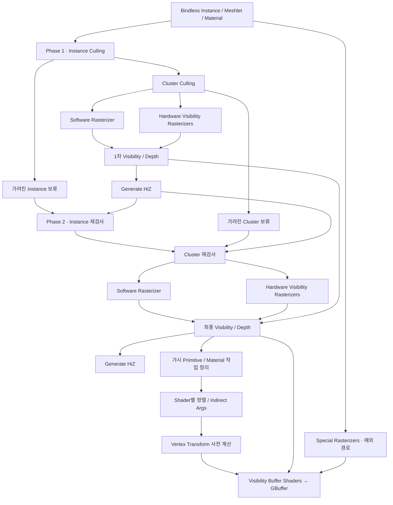
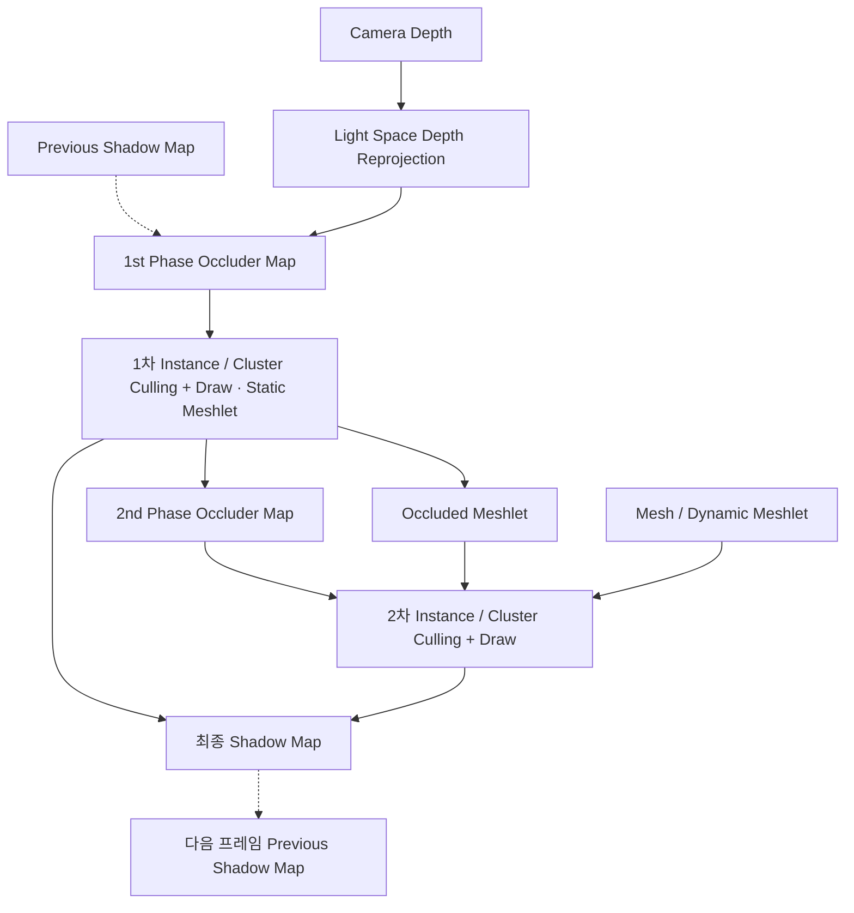
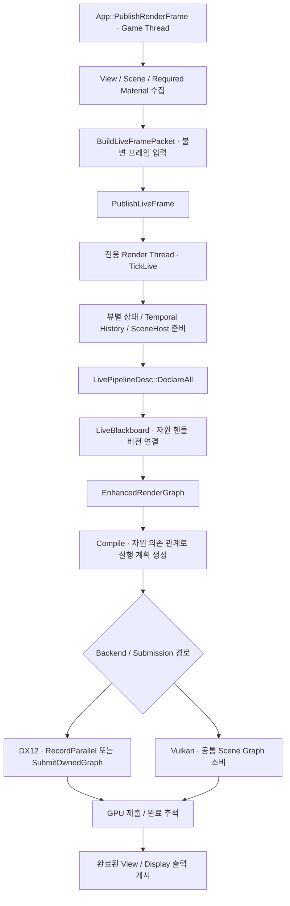
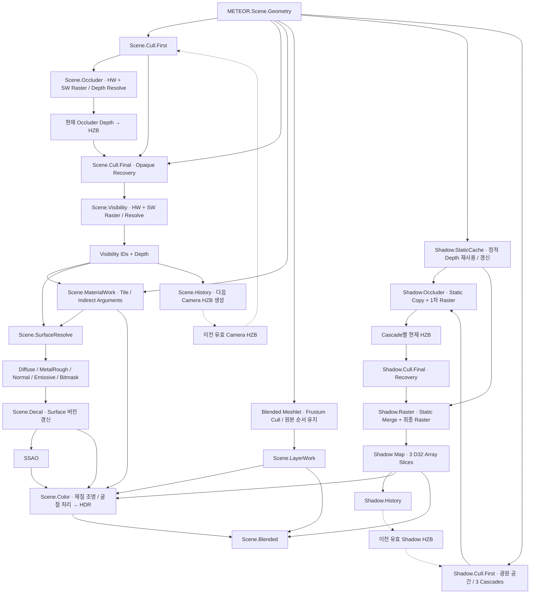
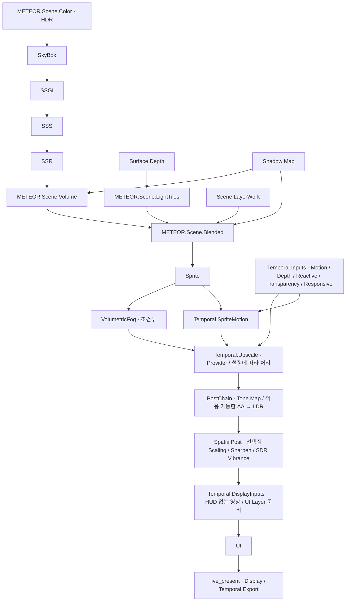

# RE ENGINE와 CreatorEngine 렌더링 배선

기준일: 2026-10-16. 기존 저장소 문서는 열거나 재사용하지 않고 작성했다.
RE는 Capcom RE ENGINE으로 해석했다. RE 쪽은 REAC 2025 발표의 Monster Hunter Wilds 경로를 기준으로 재구성했으며, 2026년 RE 전체 제품의 최신 구현을 뜻하지 않는다.
CreatorEngine 쪽은 미커밋 변경을 포함한 현재 작업 디렉터리 소스의 정적 배선이다. 빌드, 실행, GPU 캡처 검증은 수행하지 않았다.

실선은 입력·출력 의존 관계, 점선은 프레임 간 이력 또는 보조 입력이다. 병렬로 그린 가지는 동시 실행 보장이 아니다. 선택 기능은 설정·입력·지원 여부에 따라 생략되거나 입력을 그대로 전달할 수 있다.

## 1. RE ENGINE: 카메라 가시성 → 재질

근거: [Capcom, RE ENGINE Meshlet Rendering Pipeline, REAC 2025](https://enginearchitecture.org/downloads/REAC_2025_Capcom.pdf), PDF 20, 26, 28–33, 40–47쪽. 아래는 설명용 재구성이며 발표 슬라이드의 배치를 그대로 복제한 그림은 아니다.

Wilds는 Alpha Test와 Vertex Transform을 Hardware Visibility 쪽에 통합해 2단계 컬링에 포함한다. Special Rasterizer도 남아 있으므로 모든 재질이 단일 Compute Resolve만으로 처리된다고 해석하면 안 된다. 이 발표에서 확인하지 않은 전체 조명·후처리 순서는 임의로 덧붙이지 않았다.

## 2. RE ENGINE: 방향광 그림자

근거: 같은 발표 PDF 54–65쪽, 특히 65쪽의 2단계 구조.

## 3. CreatorEngine: 프레임 전달과 그래프 실행

LivePipelineDesc는 패스를 조립하고 슬롯을 연결한다. 프레임 실행 그래프는 EnhancedRenderGraph이며, 아래 패스 순서는 선언과 데이터 흐름을 표현한다. DX12와 Vulkan의 기능 동등성이나 실제 GPU 동작은 이 조사로 검증하지 않았다.

## 4. CreatorEngine: 카메라·그림자·재질 핵심 배선

이 그림의 Color → Blended는 조명 결과의 흐름을 축약한 것이다. 그 사이의 SkyBox·SSGI·SSS·SSR·Volume은 다음 그림에 펼쳤다. Cull.Final은 opaque recovery 목록과 별도로 blended 목록을 발행하며, blended는 현재 HZB recovery와 동일한 경로가 아니다. 카메라 이력은 Scene.History 선언 시점의 surface depth를 사용한다.

## 5. CreatorEngine: HDR 합성 → 화면 출력

기능 노드의 존재는 현재 프레임에서 해당 효과가 켜져 있다는 뜻이 아니다. Temporal Upscale은 HDR 합성 이후, Tone Mapping 이전에 연결되어 있다.

## 코드 근거

- `Editor/EngineEntry/App.cpp:399` — PublishRenderFrame, BuildLiveFramePacket, PublishLiveFrame.
- `Engine/RenderEngine/Render/Scene/EnhancedSceneRenderer.cpp:3583` — BuildPipelineDesc 전체 조립. 카메라 3601–3650, 그림자 3671–3755, Visibility·Material·Surface 3759–3810, HDR·합성·출력 3909–4530.
- `Engine/RenderEngine/Render/Scene/EnhancedSceneRenderer.cpp:6951` — DeclareAll 및 Compile, 명령 기록과 제출. `:8266`, `:9270` — Render Thread 소비와 TickLive.
- `Engine/RenderEngine/Render/Core/EnhancedLivePipelineDesc.h` — 읽기·쓰기·수정 슬롯과 DeclareAll 계약.
- `Engine/RenderEngine/MaterialGraphSceneFirstCullStage.inl:2` — 1차 리스트 생산.
- `Engine/RenderEngine/MaterialGraphSceneOccluderStage.inl:2` — HW/SW Occluder와 Depth Resolve.
- `Engine/RenderEngine/MaterialGraphSceneFinalCullStage.inl:2` — 현재 Pyramid를 통한 Recovery와 Frustum-only Blended.
- `Engine/RenderEngine/MaterialGraphSceneSurfaceStage.inl:2` — Visibility, MaterialWork, SurfaceResolve.
- `Engine/RenderEngine/MaterialGraphSceneShadowStage.inl:167` — Cascade별 First/Occluder/Final/Raster.
- `Engine/RenderEngine/MaterialGraphSceneHistoryStage.inl:2` — Camera History 입력.
- `Engine/RenderEngine/GpuGeometryVisibility.cpp:329` 및 `:854` — History/Recovery 준비와 FirstStage History Import.

## 비교에서 보이는 차이

| 구간 | REAC 2025 RE ENGINE | 현재 CreatorEngine 소스 |
|---|---|---|
| 카메라 | Instance/Cluster 2단계 컬링, HW/SW Visibility | First → Occluder → 현재 HZB → Final Recovery, HW/SW Visibility |
| 재질 | Visibility 기반 작업 정리, Shader별 정렬, Vertex Transform 사전 계산, GBuffer | MaterialWork의 Tile/Args → SurfaceResolve → GBuffer → Scene.Color |
| 방향광 그림자 | Camera Depth Reprojection + Previous Shadow → 2단계 Cull/Draw | StaticCache + 광원 공간 First → Occluder → 현재 HZB Recovery → Raster |
| 해석 한계 | 발표에서 공개된 특정 제품·시점의 구조 | 미커밋 변경을 포함한 정적 코드 연결, 실행 성공·성능 동등성은 미검증 |

우리 엔진의 Shadow 경로를 RE의 Camera Depth Reprojection 경로와 동일하게 그리지 않았다. 또한 비슷한 단계가 존재한다는 이유로 재질 처리 방식이나 성능이 동등하다고 판단하지 않았다.
