# 소프트웨어 RHI 명령 목록과 네이티브 번역 계층 구현 스펙

### 2026-10-21 기존 제품 경로 연결과 수용 상태

요청 기준 `09df9a16`의 문서를 master `088ea7b`의 구현·계측과 대조했다. 아래 본문은 전체 수용 계약이며, **구현된 경로와 실행으로 검증한 범위는 [구현·최적화 보고서](../analysis/RHISoftwareCompletion20261021.md)**에서 구분한다. 기본 경로 전환은 수용 전까지 보류한다.

- `RHISoftwareQueueRecorder` / `RHISoftwareCommandQueue` / `RHISoftwareQueueFactory`와 owned translator를 추가했다. DX12 owned graphics/compute는 같은 native identity·timeline에서 소프트웨어 기록, 독립 target의 병렬 번역, native 제출을 한 owner transaction으로 수행한다. 실제 worker 수를 사용하며, 중복 alias 제출과 실패 후 replay를 거절한다.
- Vulkan의 기존 graphics parallel-pool 제품 경로를 `CREATOR_RHI_SOFTWARE_COMMANDS=1`에 연결했다. immutable metadata snapshot, upload/resource/pipeline lease, 전용 descriptor recycler와 device 공통 pool budget을 사용한다. Vulkan native owned/multiqueue backend 자체를 신규 구현한 것은 아니다.
- DX12/Vulkan device incarnation을 공통 발급하고 frozen translator가 실제 장치 identity를 확인한다. owner lifecycle generation을 장치 고유 ID로 재사용하지 않는다.
- 활성 target 수와 보관 capacity를 분리해 8→1→8 기록 시 encoder/list/budget 객체를 재사용한다. DX12 owned encoder를 native allocator/list와 함께 GPU retirement 뒤 재사용하며, 제출 목록은 고정 배열 또는 owner 멤버 scratch를 사용한다.
- bool 명령 예산 거절 시 opcode·payload·logical state·sticky error를 바꾸지 않도록 수정했다. 복사 span을 갖는 간접 batch도 하나의 예약으로 기록하며 fallback이 계속 가능하다. Vulkan graphics/compute의 독립 pipeline 상태와 rendering 상태도 보존한다.
- 기존 FIFO의 queued+running software arena에 기본 256MiB admission을 추가했다. owned 경로는 같은 기본 한도에서 `Finish` 초과를 대기 없이 거절한다. CPU 저장소 해제와 GPU resource retirement는 별도이며, 아직 밀봉하지 않은 callback이나 전체 heap의 hard cap으로 해석하지 않는다.
- `RHICommandFailure`의 stage/원래 opcode 위치/backend generation/`executionUncertain`을 graph execution, owner handoff 및 submission ticket까지 전달한다. 실제 native 실행 시도와 실행 전 거부를 구분하고 기존 quarantine을 유지한다.
- record/seal/admission/translate/join/native-submit/retire 및 native query에 recording/frame/view/queue/target/backend identity를 연결했다. CPU 이벤트는 64B를 유지하고 100B sidecar를 snapshot 8/streaming 9에서 소비한다. ProfilerViewer와 Python 분석 도구는 exact/ambiguous/unmatched를 구분하며 RHI sidecar를 FPS 분모에 넣지 않는다. Vulkan offline raw timestamp와 기존에 없는 live calibrated timing producer는 구분한다.

실제 공용 RHI와 scheduler/allocator를 사용한 CPU 회귀, source-hash 고정, sanitizer 검사 및 `CE_SHIPPING=0` profiler core/codec 검사를 수행한다. DX12 native 두 프레임 readback·owned queue·timeline·pool 재사용 회귀는 추가했으나 이 Linux 호스트에서 실행하지 않았다. Vulkan CPU native-boundary 검사를 Vulkan GPU validation으로 간주하지 않는다. 따라서 §12의 제품 수용·기본 전환은 실제 Windows/GPU 실행 전까지 보류한다. `RenderGraphDeclare` 전체 노드 callback 병렬화도 별도다.


> 위 2026-10-21 상태를 우선한다. 다음 2026-10-20 대조는 고정 커밋의 감사 스냅샷이다.

<!-- master-doc-review:start -->
## 2026-10-20 master 구현 대조

기준: `27de3f5a02aadde7456aab680db3184c36ee735e`. 대시보드는 변경하지 않는다. 아래 현행 대조와 소스 선언이 이전 시점의 구조·미구현 표기보다 우선한다.

[전체 대조·링크 정리 원장](../analysis/MasterDocumentationAudit20261020.html)

### 현행 계약과 이 문서의 적용 범위

- 제품 live graph는 명시적 버전과 dependency order를 사용한다. 선언 metadata 재사용과 dependency recording은 현재 구현 기반이다.
- 소프트웨어 RHI의 frozen recording은 독립 target의 병렬 native 번역과 조기 sealed-batch handoff를 지원한다. 직렬 전용 번역·별도 C# SRP 저작 전환을 후속 필수 작업으로 두지 않는다.
- queue/alias/hazard·reader join·retirement를 보존하고 실제 overlap·fallback·whole-frame 비용으로 RG8 채택을 판정한다.

### 해당 구현에서 확인한 선언·소유 경계

- [Engine/RenderEngine/RHI/RHISoftwareBatch.h:6](https://github.com/29thnight/CreatorEngine/blob/27de3f5a02aadde7456aab680db3184c36ee735e/Engine/RenderEngine/RHI/RHISoftwareBatch.h#L6) — `class RHISoftwareRecorder;`
- [Engine/RenderEngine/RHI/RHISoftwareBatch.h:9](https://github.com/29thnight/CreatorEngine/blob/27de3f5a02aadde7456aab680db3184c36ee735e/Engine/RenderEngine/RHI/RHISoftwareBatch.h#L9) — `struct RHISoftwareRecordingStorage`
- [Engine/RenderEngine/RHI/RHISoftwareBatch.h:51](https://github.com/29thnight/CreatorEngine/blob/27de3f5a02aadde7456aab680db3184c36ee735e/Engine/RenderEngine/RHI/RHISoftwareBatch.h#L51) — `bool IsValid() const { return m_state == RHISoftwareBatchState::Sealed; }`
- [Engine/RenderEngine/RHI/IRHICommandTranslator.h:54](https://github.com/29thnight/CreatorEngine/blob/27de3f5a02aadde7456aab680db3184c36ee735e/Engine/RenderEngine/RHI/IRHICommandTranslator.h#L54) — `virtual bool Translate(RHISoftwareBatch&& softwareBatch, const RHICommandTranslationOptions& options,`
- [Engine/RenderEngine/RHI/IRHICommandTranslator.h:64](https://github.com/29thnight/CreatorEngine/blob/27de3f5a02aadde7456aab680db3184c36ee735e/Engine/RenderEngine/RHI/IRHICommandTranslator.h#L64) — `RHICommandTranslator(IRHIParallelCommandPool& pool, IRenderDeviceServices& services, RHIQueueIdentity queue)`
- [Engine/RenderEngine/RHI/IRHICommandTranslator.h:68](https://github.com/29thnight/CreatorEngine/blob/27de3f5a02aadde7456aab680db3184c36ee735e/Engine/RenderEngine/RHI/IRHICommandTranslator.h#L68) — `bool Translate(RHISoftwareBatch&& softwareBatch, const RHICommandTranslationOptions& options,`
- [Engine/RenderEngine/RHI/RHISubmissionThread.cpp:1050](https://github.com/29thnight/CreatorEngine/blob/27de3f5a02aadde7456aab680db3184c36ee735e/Engine/RenderEngine/RHI/RHISubmissionThread.cpp#L1050) — `bool RHISubmissionThread::EnqueueRecordedBatch(const void* owner,`
- [Engine/RenderEngine/RHI/RHISubmissionThread.cpp:1113](https://github.com/29thnight/CreatorEngine/blob/27de3f5a02aadde7456aab680db3184c36ee735e/Engine/RenderEngine/RHI/RHISubmissionThread.cpp#L1113) — `!pool->GetTranslationRecording(recordingId, descriptorVersion) ||`
- [Engine/RenderEngine/RHI/RHISubmissionThread.cpp:1184](https://github.com/29thnight/CreatorEngine/blob/27de3f5a02aadde7456aab680db3184c36ee735e/Engine/RenderEngine/RHI/RHISubmissionThread.cpp#L1184) — `bool RHISubmissionThread::EnqueueTranslatedBatch(const void* owner,`
- [Engine/RenderEngine/RHI/RHICommandTranslator.cpp:6](https://github.com/29thnight/CreatorEngine/blob/27de3f5a02aadde7456aab680db3184c36ee735e/Engine/RenderEngine/RHI/RHICommandTranslator.cpp#L6) — `bool RHICommandTranslator::Translate(RHISoftwareBatch&& softwareBatch, const RHICommandTranslationOptions& options,`
- [Engine/RenderEngine/RHI/RHICommandTranslator.cpp:27](https://github.com/29thnight/CreatorEngine/blob/27de3f5a02aadde7456aab680db3184c36ee735e/Engine/RenderEngine/RHI/RHICommandTranslator.cpp#L27) — `if (!m_pool.GetTranslationRecording(uploadRecordingId, descriptorVersion))`
- [Engine/RenderEngine/RHI/RHICommandTranslator.cpp:32](https://github.com/29thnight/CreatorEngine/blob/27de3f5a02aadde7456aab680db3184c36ee735e/Engine/RenderEngine/RHI/RHICommandTranslator.cpp#L32) — `if (!input.GetDesc().uploadRecordingId || !input.GetDesc().descriptorVersion ||`
- [Engine/RenderEngine/RHI/RHIEncoder.h:215](https://github.com/29thnight/CreatorEngine/blob/27de3f5a02aadde7456aab680db3184c36ee735e/Engine/RenderEngine/RHI/RHIEncoder.h#L215) — `virtual bool DrawIndexedIndirect(RHIBufferHandle, uint64_t = 0)`
- [Engine/RenderEngine/RHI/RHIEncoder.h:231](https://github.com/29thnight/CreatorEngine/blob/27de3f5a02aadde7456aab680db3184c36ee735e/Engine/RenderEngine/RHI/RHIEncoder.h#L231) — `virtual bool DispatchMeshIndirectBatch(RHIBufferHandle, uint64_t, uint32_t,`
- [Engine/RenderEngine/RHI/RHIEncoder.h:236](https://github.com/29thnight/CreatorEngine/blob/27de3f5a02aadde7456aab680db3184c36ee735e/Engine/RenderEngine/RHI/RHIEncoder.h#L236) — `virtual bool DrawIndexedIndirectBatch(RHIBufferHandle, uint64_t, uint32_t,`
- [Engine/RenderEngine/RHI/IRHIGpuProfiler.h:5](https://github.com/29thnight/CreatorEngine/blob/27de3f5a02aadde7456aab680db3184c36ee735e/Engine/RenderEngine/RHI/IRHIGpuProfiler.h#L5) — `class RHIEncoder;`
- [Engine/RenderEngine/RHI/IRHIGpuProfiler.h:10](https://github.com/29thnight/CreatorEngine/blob/27de3f5a02aadde7456aab680db3184c36ee735e/Engine/RenderEngine/RHI/IRHIGpuProfiler.h#L10) — `struct GpuPassTimingIdentity`
- [Engine/RenderEngine/RHI/IRHIGpuProfiler.h:65](https://github.com/29thnight/CreatorEngine/blob/27de3f5a02aadde7456aab680db3184c36ee735e/Engine/RenderEngine/RHI/IRHIGpuProfiler.h#L65) — `class IRHIGpuProfiler`
- [Engine/RenderEngine/RHI/RHIRecordedBatch.h:68](https://github.com/29thnight/CreatorEngine/blob/27de3f5a02aadde7456aab680db3184c36ee735e/Engine/RenderEngine/RHI/RHIRecordedBatch.h#L68) — `bool IsValid() const { return RHIRecordedBatchState::Empty != m_state; }`
- [Engine/RenderEngine/RHI/RHIRecordedBatch.h:69](https://github.com/29thnight/CreatorEngine/blob/27de3f5a02aadde7456aab680db3184c36ee735e/Engine/RenderEngine/RHI/RHIRecordedBatch.h#L69) — `bool IsReadyForSubmit() const { return RHIRecordedBatchState::Recorded == m_state; }`
- [Engine/RenderEngine/RHI/RHIRecordedBatch.h:70](https://github.com/29thnight/CreatorEngine/blob/27de3f5a02aadde7456aab680db3184c36ee735e/Engine/RenderEngine/RHI/RHIRecordedBatch.h#L70) — `bool IsSubmitted() const { return RHIRecordedBatchState::Submitted == m_state; }`
- [Engine/RenderEngine/RHI/RHIQueueRecorder.h:22](https://github.com/29thnight/CreatorEngine/blob/27de3f5a02aadde7456aab680db3184c36ee735e/Engine/RenderEngine/RHI/RHIQueueRecorder.h#L22) — `class IRHIQueueRecorder`
- [Engine/RenderEngine/RHI/RHIQueueRecorder.h:25](https://github.com/29thnight/CreatorEngine/blob/27de3f5a02aadde7456aab680db3184c36ee735e/Engine/RenderEngine/RHI/RHIQueueRecorder.h#L25) — `explicit IRHIQueueRecorder(job_scheduler& scheduler = ce::get_job_scheduler())`
- [Engine/RenderEngine/RHI/RHIQueueRecorder.h:27](https://github.com/29thnight/CreatorEngine/blob/27de3f5a02aadde7456aab680db3184c36ee735e/Engine/RenderEngine/RHI/RHIQueueRecorder.h#L27) — `virtual ~IRHIQueueRecorder() = default;`

### 이전 근거의 유효 범위

기존 세부 계약은 위 현행 구현과 모순되지 않는 범위에서 유지한다. 과거 수치·실행 통과·해시·장치 조건은 당시 기록이다. 로컬 산출물이 사라진 항목은 링크 대신 경로와 미보존 상태를 표시하며, 현재 master의 재실행 통과로 승격하지 않는다.

<!-- master-doc-review:end -->

<details data-master-history><summary>세부 계약·원래 분석과 당시 측정 기록</summary>

2026-10-20 shared visibility 입력 후속: shared descriptor scratch를 독점 non-pmr 아레나로 바꾸고, 고정 8뷰 메타데이터와 밀봉 count 입력을 재사용한다. 최종 shared 생성 평균 0.09636→0.09200ms(-4.52%), 기록 OFF 완료 처리량 55.35→57.02뷰/초(+3.00%)다. Game CPU p50은 13.41405→13.46990ms이며 120 FPS 목표는 미달이다. 32프레임·7212픽셀·shared queue header 224개 및 제품 출력 재생을 검증했다. [계측·검증](../analysis/SharedVisibilityInputs20261020.md).

작성일: 2026-10-19. 상태: 기존 제품 경로 연결 및 CPU 계약 검증, native 제품 수용 대기. 초기 기준: CreatorEngine `2935f29452698d08f4c0cf720c255ae383c3ca3f` 및 작업 트리, 로컬 UE 5.6.1 소스. 본문은 전체 구현 계약이며 현재 추가된 범위는 아래 진행 기록으로 구분한다.

GraphDeclare 후속은 선언 데이터·callback 소유자를 비-pmr 그래프 아레나에 묶고, 기하·패킷·하이브리드 가시성의 임시 목록을 재사용한다. 평균 선언 5.3156→5.0129ms, 기하 선언 0.4685→0.3563ms, Game CPU 중앙값 13.8340→13.4333ms다. 기록 OFF 완료 뷰 처리량은 54.21→54.38뷰/초이며 120 FPS 예산은 미달이다. [선언 재사용 계측·검증](../analysis/GraphDeclarationReuse20261020.md).

이전 후속(권장 1→2→4→5)은 작업 그래프·입력·segment 객체·네이티브 상태를 재사용한다. 이번 동일 조건 비교에서 Game CPU 중앙값 14.1255→13.6965ms, 기록 평균 2.1666→1.9426ms, 번역 평균 1.9076→1.7150ms다. 120 FPS 예산은 미달이다. [후속 계측·검증](../analysis/RhiSoftwareFollowup20261020.md).

이전 비-pmr·lock-free 후속의 Game CPU 중앙값은 14.1133→13.9197ms이며, 기록 OFF 완료 뷰 처리량은 51.62→53.26뷰/초다. RHI 번역 평균은 1.8541→1.8589ms로 개선되지 않았고 120 FPS 목표는 미달이다. [최종 계측·검증](../analysis/RhiSoftwareArenaOptimization20261020.md). 이전 기록·번역 검증은 기록·번역 재사용 검증 (`../../Artifacts/rhi-record-reuse-20261020/index.html` — 로컬 실행 산출물 미보존; 당시 기록으로만 참조)에 기록한다. Debug CreatorRobot의 Game CPU 중앙값은 17.3454→14.1648ms, ETW RHI 번역 평균은 4.3492→2.7257ms다. 초기 배선 검증은 비동기 제품 배선 검증 (`../../Artifacts/rhi-async-20261019/index.html` — 로컬 실행 산출물 미보존; 당시 기록으로만 참조)에 보존한다. DX12 parallel-pool 제품 RDG는 소프트웨어 기록과 RHI 스레드 직렬 번역·제출까지 연결됐다. `CREATOR_RHI_SOFTWARE_COMMANDS=1`로 명시적으로 사용한다. 기록 저장소·진단 문자열·번역 풀 재사용으로 초기 성능 회귀를 줄였다. 120 FPS의 8.333ms CPU 예산은 미달이며 기본 경로 전환 보류는 유지한다. 이 초기 기록 당시 owned/multiqueue, Vulkan 제품 전환과 병렬 번역은 후속 단계였다. 현재 연결 범위와 미완료 수용 항목은 문서 상단의 2026-10-21 기록을 따른다.

### 2026-10-19 구현 API와 수명

- `EnhancedRenderGraph::RecordSoftware`: 기존 기록 topology·barrier 계획·패스 콜백을 공유하고, native target을 열지 않고 `RHISoftwareBatch`를 밀봉한다. `RecordParallelInternal`이 두 기록 경로의 공통 실행 계획을 사용한다.
- `DX12DeviceResources::CaptureRecordingResources`: shader-visible descriptor page와 upload segment를 pin하고 추가 할당을 밀봉한다. RTV·DSV는 `DX12TargetViewHeap::Snapshot`으로 복사한다. UAV clear는 고정 page의 미사용 tail 및 전용 CPU heap을 사용한다.
- `DX12CommandListPool::CreateTranslationPool`: 현재 frame slot의 native target COM 소유권과 별도 encoder 상태, 고정 recording 자원을 묶는다. 제출 접수 전에 producer recording이 바뀌면 거절한다.
- `RHISubmissionThread::EnqueueSoftwareBatch(owner, completionSource, pool, translator, batch, ticket, error)`: 기존 용량 3의 FIFO를 공유한다. producer에서 완료점을 예약하고 다음 upload·descriptor recording을 연다. RHI 스레드에서 번역 후 native batch를 제출한다. 전체 패스 콜백을 다시 실행하지 않는다.
- `RHISubmissionTicket::GetIdentity`: `{frameId, recordingId, completion}`을 접수 시 불변 값으로 제공한다. 소프트웨어 ticket의 `GetRecordedBatch()`는 null이며 native 기록 완료를 위장하지 않는다. ticket 완료는 CPU 번역·native 제출 결과이고 GPU 완료는 completion fence로 따로 판정한다.
- `DX12SoftwareCommandValidator`: bool 반환 명령의 자원 범위·파이프라인 종류·간접 명령 signature·mesh capability를 기록 전에 검사한다.
- `RHISoftwareEncoder::RecordGpuQuery`: DX12 profiler가 기록 시 예약한 query 번호를 payload에 담고 RHI 번역 시 해당 번호에 timestamp 명령을 기록한다. tail resolve는 같은 FIFO에서 본문 뒤에 실행된다.

완료·취소되어 Available 상태가 된 descriptor page와 upload segment도 CPU lease가 남으면 재사용·trim 대상에서 제외한다. page·upload COM 자원, 복사한 CPU descriptor, native target 및 graph owner는 GPU completion retirement가 유지한다. 실패 시 자동 native fallback은 없다. 명시적 native 기준 경로와 software 경로는 같은 바이너리에서 비교한다.


### 2026-10-20 비-pmr·lock-free 재사용 후속

- `render_arena_resource`에서 pmr 상속과 가상 호출을 제거했다. Draw·RDG·제품 GPU 수명 테스트는 `render_arena_vector`/`render_arena_map`과 명시적 writer domain을 사용한다.
- `RenderArenaPool`의 mutex를 제거했다. 마지막 lease가 독점 상태로 reset한 뒤 release CAS로 게시하고, acquire exchange가 소유권과 초기화를 인수한다. 원시 포인터/size_t atomic의 lock-free 여부는 static assertion으로 고정한다. 이 보장은 풀 슬롯 경로이며, cold mimalloc 할당과 shared_ptr 수명 관리까지 wait-free라고 부르지 않는다.
- 소프트웨어 명령 헤더는 payload 포인터를 바이트 오프셋으로 바꿔 32→24바이트, Draw 기록은 48→40바이트가 됐다. `arenaBlocks`/`allocatedBytes`는 활성 저장소를, `arenaCacheHits`는 새 backing 할당 없이 활성화한 retained block 수를 센다.
- `DX12GpuProfiler::MergeSlices`는 재사용하는 연속 해시 버킷과 인덱스로 이름을 묶는다. 매 프레임 해시 노드를 할당·삭제하지 않는다. 합산 시간·span·첫 등장 순서·분할 suffix와 호출 종료 전 borrowed name 해제는 유지한다.
- 측정·검증과 120 FPS 예산 비교는 [최적화 실행 기록](../analysis/RhiSoftwareArenaOptimization20261020.md)에 기록한다.

### 2026-10-20 GraphDeclare 소유 데이터

- `render_arena_objects`는 성공적으로 생성한 객체와 배열의 소멸 기록을 보관한다. 배열 복사 실패 시 부분 생성물을 즉시 해제하며 Reset은 역순 소멸 후 블록을 재사용한다.
- 그래프의 `RetainDeclaration/CopyDeclaration/StoreExecute`가 선언 데이터와 큰 callback의 수명을 소유한다. 패스 callback 제거 후 선언 아레나를 Reset하며, 큐 기록이 점유한 그래프의 변경은 기존 idle 검사로 거절한다.
- visibility stage는 공유 frame 배열을 한 번 보관하고 stage별로 포인터를 캡처한다. packet stage는 owner/pipeline/binding 함수를 한 번 보관한다. 기하 callback은 그래프가 소유하는 연속 owner 배열을 참조한다.
- 기하 선언 scratch는 thread와 선언 깊이별로 독립된다. 합류 보조 실행의 재진입이 외부 선언 저장소를 덮지 않는다. 성공·실패·예외 반환 시 소유자와 borrowed pointer를 비운다. 중복 producer 집합은 용량을 유지하는 연속 pointer hash 슬롯을 사용한다.
- GPU 버전·자원 상태·패스 순서와 프레임별 view/world/bone 정보는 기존 선언 계약을 따른다. [전후 측정과 회귀](../analysis/GraphDeclarationReuse20261020.md).

### 2026-10-20 작업 그래프·입력·기록 객체·네이티브 상태 재사용

- `RHIRunCommandRecordingTaskGraph`는 thread-local 변환 배열과 dependency 배열 용량을 유지한다. native scheduler는 노드 수와 모든 predecessor 목록이 같은 완료 그래프를 재사용한다. 최대 8개, 그래프당 4096노드·16384 dependency를 보관하며 acquire exchange/release CAS로 독점 소유권을 전달한다. 마지막 enki callback 참조 해제 뒤 사용자 캡처·실패 상태를 비우고 풀에 게시한 다음 완료를 통지한다. scheduler 접수·종료 mutex는 유지한다.
- `SceneViewInput::Seal`은 temporal identity와 이전 draw lookup을 정렬한 thread-local 연속 배열로 처리한다. 정확한 object/incarnation/instance/mesh 조합, 중복 거절, 이전 view 일치, topology/pose 확인 계약을 유지한다. 함수 종료 시 이전 draw 포인터를 모두 비운다. geometry hash 충돌 검사도 복사한 신원 배열을 정렬하며 draw 포인터를 보관하지 않는다.
- `RHISoftwareRecordingStorage`는 target별 segment 목록·budget·encoder와 target 순서의 용량을 보관한다. 전역 풀은 최대 8개·객체 및 배열 용량 합계 16MiB이며 원자적 슬롯으로 반환한다. 명령 backing 블록은 기존 `RenderArenaPool` 한도를 별도로 따른다. 활성 segment prefix만 밀봉·집계·번역한다. recorder에서 batch로 저장소 소유권을 이동하고 마지막 CPU 번역·취소 소비 뒤 초기화하여 반환한다. 재사용 encoder는 현재 recorder의 validator를 다시 연결한다.
- `AcquireTranslationEncoder`는 frozen software 번역 풀에서 첫 segment의 native 상태를 초기화하고 이후 segment는 논리적 pipeline 바인딩만 비운다. 알려진 root signature·descriptor heaps·PSO 캐시를 유지해 같은 native 설정의 반복 호출을 생략한다. 일반 native callback 및 native command-list reset은 전체 캐시를 초기화한다. 각 패스의 Draw/Dispatch는 해당 패스의 유효 pipeline 바인딩을 여전히 요구한다.
- [후속 실행 결과](../analysis/RhiSoftwareFollowup20261020.md).

### 2026-10-20 Draw·RDG 수명별 아레나

- `ce::render_arena_resource`: mimalloc에서 64KiB 이상 원시 블록을 받고, 블록 안에서는 정렬된 오프셋을 증가시키는 비가상·비-pmr 아레나다. `render_arena_allocator<T>`가 STL 할당자 계약과 중첩 컨테이너·map value의 동일 writer domain 전달을 담당한다. 개별 `deallocate`는 저장소를 반납하지 않는다. `reset()`은 블록 주소·용량을 유지하고 사용 오프셋만 되돌린다.
- `ce::RenderArenaSet::Resource(domain)`: 세트당 4개 독립 writer 영역이다. 같은 영역의 할당은 단일 writer가 수행한다.
- `ce::RenderArenaPool::Acquire()`: `RenderArenaLease`를 반환한다. 마지막 lease가 해제될 때 세트를 reset하고 풀에 반환한다. 풀마다 유휴 세트 최대 8개·원시 블록 예약 용량 합계 16MiB를 보관한다. 한도를 넘는 저장소는 해제한다. 풀 facade보다 lease가 오래 살아도 공유 State가 반환을 처리한다.
- CPU 준비 `PreparationScratch::Work`와 RDG 컴파일·기록 임시 배열은 작업 합류 후 컨테이너·객체를 먼저 소멸시키고 lease를 반환한다. 중첩 RDG 호출과 병렬 패킷 작업은 별도 lease를 사용한다.
- 프레임 Draw/그림자 Draw/입력 범위/정렬 순서는 `FrameInput::m_cpuStorage`에 속한다. lease 필드를 컨테이너보다 먼저 선언해 마지막에 소멸시킨다. 그래프 callback과 RHI batch의 기존 lifetime token이 FrameInput을 유지하며, GPU retirement 및 마지막 CPU 소유자 해제 뒤 reset한다. 물리적인 Present 시점을 강제 reset 경계로 사용하지 않는다.
- 영속 구조 캐시, 업로드 버퍼, descriptor/native command pool은 기존 수명 계약을 유지한다. 소프트웨어 명령 아레나는 같은 비-pmr 풀을 사용하고 마지막 CPU 번역·취소 소비 뒤 블록을 재사용한다.
- 회귀 검사는 안정 주소·4096바이트 정렬·병렬 writer 영역·지연 CPU/GPU 소유자·반환 주소 재사용·보관 한도·조기 예외 종료와 실제 RHI 게이트/GPU retirement를 검사한다. 전후 측정 (`../../Artifacts/render-arena-20261020/index.html` — 로컬 실행 산출물 미보존; 당시 기록으로만 참조).

### 2026-10-20 렌더 할당자와 오류 관리

- `ce::render_allocator<T>` / `render_vector<T>`: 렌더 소유 CPU 저장소를 `mi_malloc_aligned` / `mi_free`로 관리한다. `make_render_unique<T>`는 객체와 예외 시 해제를, `make_render_shared<T>`는 객체·control block의 같은 할당자를 제공한다.
- 명령 list·encoder·공유 예산·target/segment/order 컨테이너와 RDG Resource/Pass 저장소·시그니처 오프셋에 적용했다. 공개 vector API와 중첩 컨테이너의 CRT 저장소는 유지한다. 전역 malloc/new를 대체하지 않는다.
- 소스는 `ThirdParty/mimalloc`의 고정 커밋으로 벤더링한다. C `src/static.c`만 unity/PCH 밖에서 O2로 컴파일하고 Debug에는 upstream `MI_DEBUG=2`를 유지한다. vcpkg를 사용하지 않는다.
- `RHISoftwareCommandList::GetError()`는 고정 리터럴을 참조하는 `string_view`다. `RHICommandFailure::Reset()`은 진단 문자열 용량을 보존하고 나머지 필드를 기본값으로 돌린다. translator는 segment 오류 객체를 배치 내 재사용한다.
- private heap을 파괴하지 않으며 생산 스레드 종료 뒤 소비 스레드가 해제할 수 있다. descriptor/upload/native target의 GPU retirement와 제출 FIFO 계약은 유지한다.
- 실행 근거: 할당자 전후 측정 (`../../Artifacts/render-mimalloc-20261020/index.html` — 로컬 실행 산출물 미보존; 당시 기록으로만 참조).

### 2026-10-20 기록 저장소와 번역 풀 재사용

- `RHISoftwareCommandArena`: 같은 target의 pass segment가 하나의 arena를 공유한다. 64KiB 이상 블록은 vendored mimalloc v3.5.3에서 받고 마지막 CPU 소비 뒤 아레나 풀에 반환한다. 풀은 최대 8세트·16MiB를 유지하고 초과 저장소를 `mi_free`로 반환한다. 획득은 atomic pointer exchange, 반환은 빈 슬롯 CAS로 수행하며, 슬롯에서 소유권을 획득한 스레드만 블록을 읽는다. 공용 intrusive next pointer가 없어 ABA 링크 재사용이 없다. 블록을 0으로 초기화하지 않고 payload를 생성·복사한 범위만 읽는다.
- `RHISoftwareRecorder::AcquireEncoder`: 성공 경로의 `Seal` 진단 문자열은 스레드별로 재사용해 패스마다 Debug STL proxy를 생성·소멸하지 않는다. 실패한 세션의 오류가 다음 세션에 남지 않는 회귀 검사를 포함한다.
- `RHISoftwareEncoder::Reset(list)`: target encoder를 재사용하고 pass 상태는 비운다. native `AcquireEncoder`의 pass 상태 초기화도 유지한다.
- `RHICommandRecordingStats::arenaBlocks/arenaCacheHits`: target arena가 획득한 블록 수와 과거 엔진 캐시 적중 수다. mimalloc 경로에서 `arenaCacheHits`는 항상 0이며 mimalloc 내부 재사용 횟수를 뜻하지 않는다. `allocatedBytes`는 이 블록들의 예약 용량이며 실제 malloc 바이트 수가 아니다.
- `DX12CommandListPool::CreateTranslationPool`: producer의 frame slot별 fork를 캐시한다. 외부 shared owner가 모두 사라진 fork만 재사용한다. pending CPU 번역·GPU retirement가 소유 중이면 별도 fork를 만든다. native encoder와 barrier scratch를 유지하며, 재사용 가능한 CPU RTV·DSV·UAV clear heap에 새 descriptor를 복사한다. upload·shader-visible descriptor lease와 recording ID는 매번 새 recording에서 캡처한다.
- 명령 arena는 마지막 CPU 소비·취소 시 반환한다. GPU upload·descriptor·자원 수명은 기존 retirement가 유지한다. 순회는 컨테이너를 변경하지 않는 구간에서 pointer/count span을 사용하며 전역 iterator debug 설정은 변경하지 않는다.

수정 전후의 양쪽 실행은 `CREATOR_RHI_SOFTWARE_COMMANDS=1`을 사용한다. 기록·번역 최적화 검증 (`../../Artifacts/rhi-record-reuse-20261020/index.html` — 로컬 실행 산출물 미보존; 당시 기록으로만 참조)에 결과를 기록한다.


## 1. 목표와 적용 범위

RDG 실행 콜백은 백엔드 중립 소프트웨어 명령을 기록한다. 번역 계층이 이를 네이티브 command list/buffer에 기록하고 기존 RHI 제출 소유자가 큐에 제출한다. RDG 선언, 의존성 분석, 패스 컬링, 배리어 계획, 구조 재사용은 유지한다. 전체 패스 콜백을 RHI 스레드로 옮겨 실행하는 방식은 사용하지 않는다.

이 작업은 고정 2프레임 지연 정책을 도입하지 않는다. GT publication, RT recording, RHI translation, native submission, GPU completion, presentation은 각각 다른 사건이다. 프레임 publication 하나에서 여러 뷰 제출이 만들어질 수 있으므로 제출 수를 프레임 지연으로 환산하지 않는다. 기존 최신 입력 병합과 in-flight 제한은 별도 정책으로 유지한다.

제품 전환 범위는 DX12와 Vulkan의 기존 제품 소비 경로다. DX12부터 직렬 번역을 수용하고 Vulkan 어댑터를 구현한 뒤 각 백엔드별 검증을 수행한다. Vulkan 미지원 명령을 성공으로 처리하거나 DX12 검증을 Vulkan 수용으로 확대하지 않는다. 성능 목표는 CreatorRobot Debug 120 FPS이지만, 명령 기록과 번역의 추가 비용이 있으므로 목표 달성을 이 설계의 결과로 가정하지 않는다.

## 2. 현재 구조와 전환 구조

```mermaid
flowchart LR
    A[RDG Declare and Compile] --> B[RDG callback on RT or workers]
    B --> C[RHISoftwareEncoder]
    C --> D[RHISoftwareBatch sealed]
    D --> E[RHISubmissionThread admission]
    E --> F[IRHICommandTranslator]
    F --> G[DX12Encoder or VulkanEncoder]
    G --> H[Native recorded batch]
    H --> I[Native queue submit]
    I --> J[GPU completion and retirement]
```



| 현재 경계 | 변경 계약 |
|---|---|
| `RHIEncoder` 호출이 바로 네이티브 기록 | 패스 API는 유지하고 `RHISoftwareEncoder`로 수집 |
| RT가 `IRHIParallelCommandPool`의 네이티브 target을 열고 닫음 | RT는 소프트웨어 target을 소유하고 번역기가 네이티브 풀을 소유 |
| `RHIRecordedBatch`는 네이티브 기록 결과 | 의미 유지. 소프트웨어 결과에는 별도 `RHISoftwareBatch` 사용 |
| `RHISubmissionThread`는 제출·수명 처리 | 소프트웨어 batch 번역 및 기존 네이티브 제출을 하나의 순서 계약으로 처리 |
| `IRHIQueueRecorder`의 독립 큐 기록 | software adapter도 구현하여 owned/multiqueue 경로까지 전환 |
| GPU profiler가 native encoder를 직접 확인 | 소프트웨어 marker/query 명령을 기록하고 번역 위치에서 네이티브 query를 발생 |

## 3. 파일과 타입 명칭

신규 엔진 타입은 기존 RHI 표기와 `CodingConventions.md`를 따른다. 타입·메서드는 PascalCase, 필드는 camelCase, 비공개 멤버는 `m_` 접두사를 사용한다. 범용 컨테이너는 기존 라이브러리를 사용한다. `vector<bool>`은 사용하지 않고 비트 집합에는 기존 bitset을 사용한다. 모든 if/for 본문은 여러 줄 중괄호로 작성하고 namespace 내부를 들여쓴다.

| 신규 파일 `Engine/RenderEngine/RHI/` 기준 | 타입 및 책임 |
|---|---|
| `RHISoftwareCommandTypes.h` | `RHISoftwareCommandType`, `RHISoftwareBatchState`, `RHICommandRecordingStats`, `RHICommandTranslationStats`, `RHICommandFailure` |
| `RHISoftwareCommandList.h/.cpp` | 이동 전용 `RHISoftwareCommandList`, 단일 writer, 명령 arena 및 payload 소유 |
| `RHISoftwareEncoder.h/.cpp` | `RHISoftwareEncoder final : public RHIEncoder` |
| `RHISoftwareBatch.h/.cpp` | 이동 전용 `RHISoftwareBatch`, `RHISoftwareBatchDesc`, target 순서와 의존성 |
| `RHISoftwareRecorder.h/.cpp` | `RHISoftwareRecorder`, `RHISoftwareRecordingDesc`, RT 기록 세션 |
| `IRHICommandTranslator.h` | `IRHICommandTranslator`, `RHICommandTranslationOptions`, `RHITranslatedBatch` |
| `RHISoftwareQueueRecorder.h/.cpp` | `RHISoftwareQueueRecorder final : public IRHIQueueRecorder`, 독립 큐 어댑터 |
| `DX12/DX12CommandTranslator.h/.cpp` | `DX12CommandTranslator final : public IRHICommandTranslator` |
| `Vulkan/VulkanCommandTranslator.h/.cpp` | `VulkanCommandTranslator final : public IRHICommandTranslator` |

기존 `RHIEncoder`, `RHIRecordedBatch`, `IRHIQueueCommandBatch`, `RHISubmissionTicket`, `RHICompletionPoint`, `RHITimelinePoint`를 같은 뜻의 신규 타입으로 복제하지 않는다. 기존 `RHIRecordedBatch::GetCommandCount()`는 native target 수를 뜻하므로 소프트웨어 opcode 수로 재해석하지 않는다.

## 4. 공개 API 계약

아래는 선언 계약이다. 기존 프로젝트의 include/forward declaration 및 소유권 도구에 맞춘 헤더 분할은 구현 단계에서 수행한다. API 이름과 반환 의미는 유지한다.

### 4.1 기록 세션

```cpp
struct RHISoftwareRecordingDesc
{
    RHIQueueIdentity queue;
    uint32_t targetCount{ 0 };
    uint64_t maxCommandBytes{ 0 };
    uint64_t maxPayloadBytes{ 0 };
};

class RHISoftwareRecorder final
{
public:
    bool BeginRecording(const RHISoftwareRecordingDesc& desc, std::string& outError);
    RHIEncoder& AcquireEncoder(uint32_t target);
    bool FinishRecording(std::span<const uint32_t> targetOrder,
        const RHISoftwareBatchDesc& desc, RHISoftwareBatch& outBatch,
        std::string& outError);
    void CancelRecording();
    RHICommandRecordingStats GetRecordingStats() const;
};
```

- `BeginRecording`는 비활성 세션에서만 성공한다. targetCount와 두 예산은 0보다 커야 한다. 이 호출로 네이티브 allocator/list를 reset하거나 upload prefix를 제출하지 않는다.
- 초기 recorder는 총 예산을 target 수로 균등 분할하고 나머지 byte를 앞 target부터 배정한다. 같은 target의 여러 pass segment는 예산을 공유한다. 다른 target끼리는 명령별 공용 atomic 카운터를 갱신하지 않는다. target별로 독점 기록한 뒤 owner가 합류하여 통계를 합산한다. 두 예산이 target 수보다 작으면 시작을 거부한다.
- `AcquireEncoder`는 활성 세션의 유효 target에서만 호출한다. 새 pass/slice 상태를 시작하며 같은 target에 동시에 두 writer가 접근하면 계약 위반이다. worker 번호는 물리 스레드 번호가 아니다. 범위 오류는 기존 엔진 assertion 계약으로 진단하고 해당 세션을 실패시킨다.
- target당 opcode 순서는 기록 순서다. 서로 다른 target은 독립적으로 기록할 수 있다. `FinishRecording` 전에 모든 writer가 합류해야 한다. 이전 encoder 참조는 다음 acquire 또는 finish/cancel 이후 사용할 수 없다.
- `FinishRecording`은 출력이 비어 있고 targetOrder가 유효하며 중복이 없을 때만 성공한다. 비어 있지 않은 target을 누락하면 실패한다. 빈 target은 제출 목록에서 제외할 수 있다. 의존성은 RDG compiled execution 계획에서 복사하며 임의의 target 완료 순서를 실행 순서로 사용하지 않는다.
- 실패하면 부분 batch를 출력하지 않는다. `CancelRecording`은 합류 이후에만 호출하며, 아직 네이티브로 실행되지 않은 payload를 정확히 한 번 해제한다.

### 4.2 소프트웨어 목록과 batch

`RHISoftwareCommandList`의 엔진 내부 API는 `GetCommandCount()`, `GetCommandBytes()`, `GetPayloadBytes()`, `IsSealed()`이다. 명령 추가는 friend인 `RHISoftwareEncoder`에만 허용하며 임의 lambda를 등록하는 공개 API는 제공하지 않는다.

`RHISoftwareBatchDesc`에는 `frameId`, `sourceEngineFrame`, `sourceEngineFrameAvailable`, `renderViewId`, `backendGeneration`, `displayToken`, `uploadRecordingId`, `descriptorVersion`, `queue`, 조건부 `captureContext`, `lifetimeToken`을 둔다. `queue`는 기존 `RHIQueueIdentity`이며 device incarnation을 함께 검증한다. GPU query의 실제 fence/submission 번호는 native admission에서 연결한다. CPU 프레임과 capture provenance는 기록 시 동결한다.

`RHISoftwareBatch` 공개 API는 `IsValid()`, `GetState()`, `GetDesc()`, `GetRecordingId()`, `GetTargetCount()`, `GetRecordingStats()`다. `GetDesc()`는 const 참조를 반환하며 이동·파괴 이후 보관할 수 없다. 외부 상태 변경 setter는 두지 않는다. recorder, translator, submission owner만 상태를 전이한다.

### 4.3 번역

```cpp
enum class RHICommandTranslationMode : uint8_t
{
    Serial,
    Parallel
};

struct RHICommandTranslationOptions
{
    RHICommandTranslationMode mode{ RHICommandTranslationMode::Serial };
    uint32_t maxTranslationJobs{ 1 };
    uint64_t minCommandsPerJob{ 0 };
};

class IRHICommandTranslator
{
public:
    virtual ~IRHICommandTranslator() = default;
    virtual bool Translate(RHISoftwareBatch&& softwareBatch,
        const RHICommandTranslationOptions& options,
        RHITranslatedBatch& outBatch, RHICommandFailure& outFailure) = 0;
};
```

`Translate`는 호출 직후 입력을 소비한다. 실패해도 재제출·재번역할 수 없다. 출력은 성공 시에만 유효하며 번역 실패는 GPU 제출 성공을 뜻하지 않는다. `RHITranslatedBatch`는 이동 전용 tagged container로 기존 단일 풀 `RHIRecordedBatch` 또는 독립 큐 `IRHIQueueCommandBatch`와 번역 통계를 소유한다. 태그 이름은 `RHITranslatedBatchKind::ParallelPool`과 `OwnedQueue`다. 독립 큐 batch는 기존 인터페이스가 요구하는 shared ownership을 유지하되 wrapper의 제출 권한은 단일 소유한다.

`RHITranslatedBatch`에는 `GetKind()`, `IsValid()`, `GetTranslationStats()`만 공개한다. 내부 native payload 접근·소비는 제출 소유자에 한정한다. software batch를 native batch인 것처럼 기존 enqueue에 넘기는 형변환은 금지한다.

초기 `RHICommandTranslator`는 준비된 native pool, `IRenderDeviceServices`, 실제 대상 `RHIQueueIdentity`를 생성자에서 받는다. `DX12CommandTranslator`와 `VulkanCommandTranslator`는 typed pool/resources 어댑터다. 직렬 번역은 batch에 저장한 upload/descriptor 버전과 현재 준비 버전이 다르면 거부한다. 비동기 버전 lease가 구현되기 전에는 이 검사를 제거하거나 현재 버전으로 바꿔 실행하지 않는다.

`IRHISoftwareCommandValidator::Validate(type, arguments, argumentBytes, state)`는 bool 명령의 사전 검증 API다. `RHISoftwareEncoderState`의 `boundPipeline/bindPoint`는 해당 encoder의 성공한 `SetPipeline` 기록을 반영한다. 여러 target의 pipeline 상태를 validator 내부 mutable 전역 값으로 공유하지 않는다.

### 4.4 제출 진입점

`RHISubmissionThread`에 다음 API를 추가한다.

```cpp
bool EnqueueSoftwareBatch(const void* owner,
    RHISoftwareBatch&& batch,
    const RHICommandTranslationOptions& options,
    RHISubmissionTicket& outTicket, std::string& outError);
```

반환 false는 큐 admission 거부이며 ticket은 유효하지 않다. **입력 소유권은 성공할 때만 큐로 이동한다.** 이 규칙은 입력을 항상 소비하는 `Translate`와 다르다. 큐 예산·owner generation·backend generation을 먼저 검사하고 이동한다. 반환 true는 작업을 받았다는 뜻이며 번역이나 native 제출의 성공이 아니다.

RHI 소유자는 등록된 디바이스의 translator를 사용한다. producer가 translator raw pointer나 참조를 lambda에 캡처하지 않는다. backend 등록 수명은 owner drain까지 보장한다. RHI 스레드 내부에서 기존 공개 enqueue를 다시 호출하고 ticket을 기다리는 재진입은 금지한다. native batch 제출용 private helper `SubmitTranslatedBatch`를 호출한다.

`RHISubmissionTicket`의 완료는 CPU native 제출 결과를 뜻하도록 유지한다. 번역 완료 시 ticket을 성공 처리하지 않는다. GPU 완료는 기존 `RHICompletionPoint` 또는 큐별 `RHITimelinePoint`로 판단한다. 아직 발행되지 않은 timeline value를 외부 queue wait의 유효 ready point로 노출하지 않는다.

직렬 번역의 native 수용 검사는 중간 API `EnqueueTranslatedBatch(owner, completionSource, translatedBatch, outTicket, outError)`를 사용한다. 이 함수는 이미 native 기록을 마친 `ParallelPool` 결과를 기존 `EnqueueRecordedBatch`에 넘긴다. 소프트웨어 기록을 RHI 스레드에서 번역하는 `EnqueueSoftwareBatch`와 구분하며, 이 중간 API의 사용을 비동기 전환 완료로 판정하지 않는다.

### 4.5 독립 큐 어댑터

`RHISoftwareQueueRecorder`는 기존 `Record`, `BeginRecording`, `GetWorkerCount`, `DeviceServices`, `ExecuteSubmission` 시그니처를 구현한다. 여기서 `GetWorkerCount`는 software target 수다. `IRHIQueueRecording::Finish`는 소프트웨어 payload를 담은 `RHISoftwareQueueCommandBatch final : public IRHIQueueCommandBatch`를 생성한다. 실제 native queue 소비 지점이 이 payload를 번역하여 기존 native batch로 대체한다.

`RHISoftwareQueueCommandBatch`는 기존 batch 인터페이스의 `GetQueueIdentity()`와 `GetRecordingId()`를 구현한다. 실제 실행 진입점은 batch가 아니라 `IRHICommandQueue::Submit`이다. 이 경계를 감싸는 `RHISoftwareCommandQueue final : public IRHICommandQueue`를 `RHISoftwareQueueRecorder.h/.cpp`에 함께 추가한다. `GetIdentity`, `Signal`, `Wait`, `Submit`, `CollectCompleted`, `GetPendingBatchCount`의 기존 서명을 유지한다. 생성은 `RHISoftwareQueueFactory final : public IRHICommandQueueFactory`로 감싸고 `QueryQueueCapabilities/CreateQueue`를 위임한다. native queue와 software queue의 논리 identity는 동일하며 새 GPU 큐를 만들지 않는다.

software queue의 `Submit`은 제출 소유자에서 software payload를 번역하고 native queue에 제출한 뒤 발행된 timeline point를 반환한다. `ExecuteSubmission`은 이 전체 transaction을 소유자에게 한 번 전달하고 CPU admission 결과까지 반환하되 GPU 완료는 기다리지 않는다. 기존 `Submit`의 동기 반환 계약을 유지하기 위해 이 경로는 번역 전에 가짜 issued point를 반환하지 않는다. 비동기 `EnqueueSoftwareBatch`의 ticket 경로와 구별한다. 동일 software queue에서 pending translation을 건너뛰고 후속 `Wait/Signal/Submit`이 실행되지 않도록 transaction 순서를 직렬화한다.

native 명령이 없는 소프트웨어 batch를 네이티브 완료 상태로 위장하지 않는다. cross-queue wait/signal, queue family ownership은 compiled queue 계획을 보존한다. `CollectCompleted/GetPendingBatchCount`는 wrapper가 소유한 admission과 native retirement의 일관된 집계를 제공하고 같은 batch를 두 번 세지 않는다.

## 5. 명령 목록과 인자 소유권

초기 내부 명령은 `RHISoftwareCommandList::Command`의 `type/next/replay/payload`와 typed payload로 구성한다. payload는 trivially destructible로 제한하고 명령별 소멸 콜백을 두지 않는다. 재배치하지 않는 target arena block에 저장하므로 header와 복사한 span의 주소를 유지한다. alignment와 byte 예산을 확인하고 크기 덧셈·배열 크기 곱셈이 overflow하기 전에 거부한다. payload는 저장소가 직접 만들고 외부 offset을 받지 않는다. 이 레이아웃은 프로세스 내부 전용이며 파일 직렬화 ABI가 아니다.

`RHISoftwareCommandType`은 아래 기존 API 이름과 동일한 열거자를 가진다. 각 opcode 구현은 양 백엔드가 아니라 **현재 RHIEncoder 전체 인터페이스**를 기준으로 coverage 검사한다.

| 범주 | 유지하는 RHIEncoder API 및 대응 opcode |
|---|---|
| 상태 | `SetViewportAndScissor`, `SetViewport`, `SetScissor`, `SetPipeline`, `SetPrimitiveTopology` |
| 바인딩 | `SetBindings`, `SetSamplers`, `SetConstantBuffer`, `SetRootBuffer`, `SetRootUnorderedBuffer`, `SetVertexBuffer`, `SetIndexBuffer` |
| draw | `Draw`, `DrawIndexed`, `DrawIndirect`, `DrawIndexedIndirect`, `DrawIndexedIndirectBatch` |
| dispatch | `Dispatch`, `DispatchIndirect`, `DispatchMesh`, `DispatchMeshIndirect`, `DispatchMeshIndirectBatch` |
| raster | `BeginRasterWithoutAttachments`, `BindRenderTargets`, `ClearRenderTargets`, `ClearDepthTarget`, `ClearRenderTargetRect` |
| barrier | `ResourceBarriers`, `UavBarrier`, `UavBarrierBuffers` |
| copy | `CopyResource`, `CopyTexture`, `CopyBuffer`, `ClearUnorderedAccess` |
| readback copy | `CopyToReadback`, `CopyVolumeToReadback`, `CopyPartialToReadback`, `CopyBufferToReadback` |
| 계측 추가 opcode | `BeginGpuPass`, `EndGpuPass`, `ResolveGpuQueries`, `BeginDebugEvent`, `EndDebugEvent` |

`GetComputeDispatchCount`는 query이므로 opcode가 아니다. 향후 RHIEncoder에 메서드를 추가하면 coverage manifest와 recorder/translator/회귀 검사를 함께 변경한다.

| 인자 | 기록 시 규칙 | 해제 시점 |
|---|---|---|
| 정수·enum·rect·색상 | 값 복사 | 번역 후 |
| span·barrier 배열·root slot 배열·문자열 | arena에 깊은 복사, 호출자 주소 보관 금지 | 번역 후 |
| texture/buffer/pipeline handle | 값과 generation 검증 + 실제 객체 소유 pin | GPU 완료 후 |
| descriptor/sampler table | table 값 복사 + 해당 heap/version lease 유지 | GPU 완료 후 |
| `RHIBufferSlice` | handle/offset/size 복사, cpuAddress는 재생에 사용하지 않음 | allocation/upload page는 GPU 완료 후 |
| readback 대상 | descriptor 복사 + readback allocation pin | GPU 완료 및 기존 CPU reader 계약까지 |
| query heap 및 결과 저장소 | query slot 예약 + profiler 세대 pin | GPU 완료·수집/폐기까지 |

handle generation은 소유권이 아니다. `lifetimeToken`은 모든 참조 자원과 descriptor/upload version을 실제로 붙잡아야 한다. 목록 단위 pin 집합을 재사용하고 같은 자원 pin을 중복 증가시키지 않는다. 명령마다 shared_ptr나 std::function을 생성하지 않는다. non-trivial payload는 실행 성공·실패·취소 모두 destructor가 정확히 한 번 호출되도록 등록한다.

## 6. 반환값과 오류 계약

bool-returning encoder API의 true는 입력 검증 및 software 기록 수락이다. false면 명령 추가와 encoder 상태 변화가 모두 없어야 하며 기존 fallback 호출이 안전해야 한다. capability, offset/alignment, argument size, pipeline/queue 지원 여부처럼 기록 전에 판단 가능한 조건은 즉시 검사한다.

void API의 할당·검증 실패는 recording session에 sticky failure로 저장한다. 이후 명령을 성공으로 처리하지 않고 `FinishRecording`이 실패한다. 일부 유효 명령만 골라 제출하지 않는다. 네이티브 resource 생성 실패나 device loss처럼 번역 때 드러나는 오류는 batch 실패이며, 기록 당시 bool 결과를 소급 변경하지 않는다.

`RHICommandFailure` 필드는 `stage`, `recordingId`, `targetIndex`, `commandIndex`, `commandType`, `backendGeneration`, `message`다. `stage` enum은 `Recording`, `Admission`, `Translation`, `Submission`, `Retirement`다. 아직 opcode가 없는 실패에는 index sentinel을 쓴다. GPU 실행 여부를 알 수 없는 native 실패는 별도 `executionUncertain` 플래그로 기록하고 자원을 quarantine한다. 재시도로 같은 draw를 중복 실행하지 않는다.

기존 `GetComputeDispatchCount()`는 software encoder에서 `UINT64_MAX`를 반환한다. 기존 native count를 논리 기록 수로 바꾸지 않는다. 논리 개수는 `RHICommandRecordingStats::computeDispatchCommands`, 실제 emit 수는 `RHICommandTranslationStats::nativeComputeDispatches`로 분리하고 소비처를 명시적으로 이관한다.

## 7. 상태와 스레드 소유권

`RHISoftwareBatchState`: `Empty`, `Sealed`, `Queued`, `Translating`, `Translated`, `Failed`, `Cancelled`. recorder의 활성 writer는 batch 밖의 Recording 상태다. 번역 입력이 소비된 후 software batch 객체는 비며 native 완료 상태는 `RHITranslatedBatch`와 기존 native batch가 소유한다. `Translated`는 진단 이력이며 software 객체를 GPU 완료까지 보관해야 한다는 의미가 아니다.

| 구간 | 소유자 | 허용 작업 |
|---|---|---|
| 기록 | RT 및 target별 worker | CPU payload 기록, 미리 준비된 서비스 데이터 사용 |
| 밀봉 | 모든 writer 합류 후 RT | target 순서/의존성 동결, 소유권 전달 |
| admission | 제출 큐 잠금 경계 | 예산 예약, 세대 확인, batch 이동 |
| 직렬 번역 | RHI 소유자 | native target 준비·기록·닫기 |
| 병렬 번역 | 전용 target lease를 가진 공용 scheduler job | 독립 native context만 사용 |
| 제출 | RHI 소유자 | queue wait/execute/signal 및 ticket 결과 확정 |
| retirement | 기존 fence 수집 경로 | native allocator, transient 및 pin 퇴거 |

RT가 계속 recording하더라도 RHI 번역기의 native pool frame slot을 reset할 수 없다. native pool 재사용은 해당 GPU fence 완료 이후다. 여러 frame의 descriptor/upload 버전이 동시에 살아 있어야 하며 전역 mutable currentFrame 값을 번역 시 다시 읽지 않는다.

## 8. 업로드와 자원 준비 경계

자원 생성, map, descriptor 생성, CPU 데이터 채움, PSO 준비는 초기 단계에서 기존 준비 서비스에 남긴다. 소프트웨어 encoder는 이 작업을 임의로 지연시키지 않는다. 기존 `IRHIParallelCommandPool::Prepare`의 upload prefix 제출과 upload/descriptor version 시작은 다음처럼 분해한다.

1. CPU 준비 단계 `PrepareRecordingResources`: 필요한 lease/version을 얻고 CPU 채움을 끝낸다.
2. 번역/제출 소유자 `SubmitUploadPrefix`: prefix를 정확히 한 번 실행하고 같은 큐 순서 또는 명시적 timeline dependency를 확보한다.
3. 본문 번역 및 native 제출: 고정된 version만 참조한다.

두 이름은 backend 내부 helper다. prefix를 이미 제출했다면 이후 본문 번역 실패를 '프레임의 GPU 작업이 전혀 실행되지 않음'으로 기록하지 않는다. prefix 자원도 완료점까지 보존한다. 준비 서비스가 RHI 스레드에서만 허용되는 경우에는 선행 작업 dependency로 분리하며 recording worker가 RHI ticket을 잡고 순환 대기하지 않게 한다.

## 9. 프로파일러와 타임라인

기존 `IRHIGpuProfiler::BeginPass/EndPass`는 유지한다. software 경로에서는 query slot과 이름·`GpuPassTimingIdentity`를 기록 시 예약하고 `BeginGpuPass/EndGpuPass`를 추가한다. `ResolveGpuQueries`는 마지막 query 쓰기 이후의 native 위치에 emit한다. `DX12Encoder` dynamic_cast 성공에 의존하는 경로는 profiler backend adapter로 분리한다. query 공간 부족은 명시적 timing-unavailable로 표시하며 draw 실패와 구별한다.

신규 CPU 스코프 이름은 `RHISoftwareRecord`, `RHISoftwareSeal`, `RHISoftwareAdmissionWait`, `RHICommandTranslate`, `RHICommandTranslateJoin`, `RHINativeSubmit`, `RHIBatchRetire`로 고정한다. 기존 `RenderGraphDeclare`, compile, scene prepare 스코프를 포함해 겹침을 보존한다. command별 CPU 스코프는 기본 OFF이며 동일 계측 조건 비교에서만 활성화한다.

모든 이벤트에 recordingId, sourceEngineFrame availability, frameId, viewId, queue identity, targetIndex, backend generation을 연결한다. CPU record/translate/submit 시간, ETW Running/Ready/Waiting, GPU timestamp, Present를 별도 lane으로 표시한다. trace에 정보가 없으면 unknown으로 표시하고 Running으로 추정하지 않는다. 프레임 지연은 publication/record/submit/present의 동일 provenance 매칭으로 측정한다.

## 10. backpressure와 종료

큐 entry 제한, 소프트웨어 arena byte 제한, GPU in-flight slot 제한을 함께 적용한다. 소프트웨어 큐와 기존 네이티브 큐에 각각 최대 용량을 추가해 총 지연을 두 배로 늘리지 않는다. admission부터 retirement까지 공유되는 제출 credit을 사용하고 CPU arena byte credit은 번역·폐기 완료 시 별도로 반환한다. 제출 credit은 GPU 완료 또는 미제출 확정 취소 때 반환한다.

현재 구현의 CPU 제한은 `RHISubmissionThread::kSoftwareByteCapacity`와 owned domain의 `RHISoftwareQueueOptions::maxPendingArenaBytes`로 각각 선택한 소비 경로에 적용한다. 한 software batch를 두 큐에 중복 접수하지 않는다. 전자는 기존 용량 3 FIFO의 대기 조건이며, 후자는 그래프가 기록을 먼저 모으는 계약 때문에 `Finish`에서 대기 없이 거절한다. `allocatedBytes`의 queued/sealed+running 합계를 세고 CPU 저장소 소멸 뒤 반환한다. 기존 backend frame slot·completion retirement가 GPU 자원 수명을 제한한다. 아직 Finish하지 않은 모든 producer 기록의 순간 arena peak나 전체 process RSS 상한을 추가한 것은 아니다.

resize/reload/backend 교체는 이전 generation의 신규 admission을 차단하고, 미번역 batch를 취소하거나 명시적으로 drain한다. 이미 제출한 자원은 GPU 완료까지 보존한다. shutdown은 producer 중지 → recording jobs 합류 → admission 차단 → 번역/제출 drain → GPU retirement → profiler/native pool 해체 순서다. device loss 또는 실행 불명확 실패는 기존 quarantine 정책을 따른다.

## 11. 병렬 번역

공용 `RHICommandTranslationOptions`의 기본은 Serial이다. 현재 소프트웨어 제품 선택 경로는 독립 target이 있는 pool/owned recorder에서 Parallel을 사용하되 작은 명령 묶음은 RHI 소유자가 직접 번역한다. `minCommandsPerJob`는 조정 가능한 측정 파라미터다. 연결부의 256은 master의 기존 정책을 유지한 값이며, 실제 장면에서 최적인 임계값으로 확정하거나 CPU fixture만으로 기본 경로 전환을 승인하지 않는다.

분할 단위는 RDG가 허용한 독립 target/context 경계다. 한 stateful command stream을 임의 명령 번호에서 잘라 상태를 잃지 않는다. 앞 상태가 필요한 target은 명시적 state prologue 또는 동일 context 순차 실행으로 보장한다. native list 완료 순서와 제출 순서는 구별하고 compiled dependency/order를 제출 시 복원한다. 자원/descriptor registry 조회는 번역 중 안전한 immutable snapshot 또는 lease를 사용한다.

번역 job은 기존 엔진 scheduler를 사용한다. 새 thread pool을 추가하지 않는다. target별 predecessor만 기다리고 불필요한 전체 wave barrier를 만들지 않는다. 합류 보조 실행은 scheduler의 허용된 task만 수행하며 thread-affine native 조작을 임의 worker에 넘기지 않는다. queue wait와 GPU fence는 CPU 번역 dependency를 대체하지 않는다.

## 12. 변경 파일과 구현 순서

| 순서 | 작업 | 완료 조건 |
|---|---|---|
| 1 | API/command coverage와 반환값 소비처 inventory | `RHIEncoder` 모든 메서드·native cast·직접 서비스 명령·양 RDG 기록 경로 목록 확보 |
| 2 | 타입·arena·list·batch·recorder | 이동·밀봉·취소·overflow·alignment·destructor 검사 통과 |
| 3 | `RHISoftwareEncoder` 전체 명령 | borrowed payload 파괴 후에도 동일 기록 재생, false의 무부작용 검증 |
| 4 | `DX12CommandTranslator` 직렬 | clear/bind/draw/dispatch/barrier/readback 전 과정 및 전체 명령 coverage 통과 |
| 5 | `RHISubmissionThread.h/.cpp` 연결 | admission/ticket/fence 의미, stale generation, 취소·실패·quarantine 검사 통과 |
| 6 | `EnhancedRenderGraph.h/.cpp` 전환 | `PrepareParallel/RecordParallel`에서 software target 사용, callback 1회 실행 |
| 7 | `RHIQueueRecorder` adapter 및 queue 소비처 | owned/multiqueue wait/signal과 deterministic 제출 순서 검증 |
| 8 | `IRHIGpuProfiler`, DX12/Vulkan profiler·capture | CPU/GPU identity 및 query resolve 위치, recording ON/OFF 검사 |
| 9 | `VulkanCommandTranslator` 및 생명주기 | 백엔드별 validation, resize/reload/종료 및 pool 재사용 검증 |
| 10 | 병렬 번역 및 작은 batch 직렬 처리 | serial 대비 동일 출력, target 독점, 순서·상태·수명 검사 |
| 11 | 제품 수용 및 기본 경로 전환 | CreatorRobot Debug 정확성·ON/OFF·ETW/GPU 전후 비교와 회귀 통과 |

각 신규 .h/.cpp는 `RenderEngine.vcxproj`와 `.filters`에 등록한다. 기존 네이티브 직접 기록은 별도 진단 빌드 설정에서만 A/B 기준으로 보존한다. 제품 software 경로 실패 시 자동 native fallback하여 오류를 숨기지 않는다. 수용 전에는 기존 제품 기본 경로를 바꾸지 않는다.

## 13. 회귀 검사와 수용 기준

회귀 도구 예정 경로는 `Tools/regression/rhi_software_commands_probe.cpp`와 `Tools/regression/verify-rhi-software-commands.ps1`이다. 실제 엔진 API를 사용하고 mock 기록 성공만으로 native 수용을 판정하지 않는다.

- 명령·payload 경계: 임시 문자열/배열 파괴, arena 성장, 0개/대용량, 잘못된 offset, 예산 초과, bool false 후 fallback, destructor 횟수, 이동 후 원본 무효화.
- 수명: 자원 소유자를 기록 직후 해제, descriptor/upload ring wrap, scene reload, resize, backend generation 변경, submit 직전 실패, 제출 후 timeout/device loss. GPU 완료 전 allocator 재사용이 없어야 한다.
- 실행: 기존 direct와 software serial/parallel의 색상·깊이·readback 비교. 기존 허용 오차를 사용하고 tolerance를 이 변경을 위해 완화하지 않는다. indirect/mesh/copy/UAV 및 queue handoff를 포함한다.
- 순서: callback 한 번, 명령 순서 보존, target 간 dependency, 동일 frame 여러 view, native submit 이전 ticket 성공 금지, 미발행 fence wait 거부, RHI 재진입 교착 부재.
- 계측: GPU pass 수·identity·query 구간과 CPU provenance가 일치한다. unavailable query는 누락 사유와 수량을 남긴다.
- 제품: CreatorRobot Debug 플레이 시작·정상 진행·장면 재로드·플레이 종료·정상 shutdown을 실행한다. DX12/Vulkan 검증 결과는 독립 기록한다.

성능 비교는 같은 소스·장면·해상도·worker 수·전경 상태·워밍업·측정 구간·계측 옵션으로 direct/serial/parallel을 순서를 바꾸어 반복한다. 기록 ON/OFF와 ETW를 분리하고 GPU validation은 정확성 실행과 구별한다. 평균/p50/p95/p99 및 spike, FPS 산출 구간, full-frame critical path, CPU Running/Ready/Waiting, arena/allocator 메모리, in-flight 및 입력→표시 지연을 함께 보고한다. RenderGraphDeclare 개선으로 귀속할 수 없는 번역 효과를 선언 비용 감소로 표기하지 않는다.

## 14. 근거 소스와 UE 대응

| 근거 | 확인 대상 |
|---|---|
| [RHIEncoder.h](../../Engine/RenderEngine/RHI/RHIEncoder.h) | 현재 패스 명령 표면과 bool/count 계약 |
| [RHIRecordedBatch.h](../../Engine/RenderEngine/RHI/RHIRecordedBatch.h) | native batch, generation, lifetime token |
| [RHIParallelCommandPool.h](../../Engine/RenderEngine/RHI/RHIParallelCommandPool.h) | native target 준비·기록·밀봉 |
| [RHIQueueRecorder.h](../../Engine/RenderEngine/RHI/RHIQueueRecorder.h) | owned queue의 두 번째 기록 경로 |
| [RHISubmissionThread.cpp](../../Engine/RenderEngine/RHI/RHISubmissionThread.cpp) | FIFO admission, native 제출, retirement |
| [IRHIGpuProfiler.h](../../Engine/RenderEngine/RHI/IRHIGpuProfiler.h) | query identity와 frame/submission 구분 |
| [EnhancedRenderGraph.cpp](../../Engine/RenderEngine/Render/Graph/EnhancedRenderGraph.cpp) | graph recording 전환 지점 |
| [CodingConventions.md](CodingConventions.md) | 타입·API 표기와 코드 형식 |

UE 기준 루트: `C:/Program Files/Epic Games/UE_5.6/Engine`, 버전 5.6.1 CL44394996.

| UE 상대 경로 | 대응 설계 |
|---|---|
| `Source/Runtime/RHI/Public/RHICommandList.h`의 `FRHICommandBase`, `AllocCommand`, `AllocCopy` | typed software command, arena와 인자 소유 |
| `Source/Runtime/RHI/Private/RHICommandList.cpp`의 `FinishRecording`, `Execute` | 밀봉과 명령 재생 분리 |
| 같은 파일의 `FTranslateState`, `EnqueueTranslateTask`, `EnqueueSubmitTask`, `Finalize` | 번역 task와 순서화된 native 제출 분리 |
| `Source/Runtime/RenderCore/Private/RenderGraphBuilder.cpp`의 `SetupParallelExecute` | RDG 실행 분할과 context 경계 유지 |

UE의 명령 분리 원칙을 현재 RHI 경계에 적용한다. UE의 allocator 구현, linked-list 저장 형식, task thread 배치, 모든 RDG 기능을 동일하게 복제하는 계약은 아니다. UE식 명령 목록 도입과 고정 프레임 지연 설정은 별도다.

## 15. 노드 선언 직렬화와 CPU 저장소 재사용 — 2026-10-21 수정

제품 `LivePipelineDesc::DeclareAll`은 활성 노드를 등록 순서대로 한 번씩 선언한다. 노드별 분기 그래프, 입력 스냅샷, `Wait → Merge → Publish` 경로와 `RGSetupTaskGraph`를 제거했다. `parallelDeclare`, `setupDependencies`, `CreateDeclarationBranch`, `MergeDeclarationBranch`는 제공하지 않는다. 노드 선언 병렬화를 구현 완료로 표시하지 않는다. 소프트웨어 명령 목록의 기존 병렬 기록과 비동기 RHI 번역·제출은 유지한다.

- 반복 패스 장벽 계획은 물리 원소를 유지하고 활성 개수만 초기화한다. 각 원소의 전환·UAV 배열 용량을 보존한다. graph `Reset`은 기존 queue/GPU 완료 계약을 따른다.
- `IndirectMaterialBatchPool`은 준비 소유 스레드가 회수한다. 풀 외부의 공유 소유자가 하나라도 남으면 해당 묶음을 재사용하지 않는다. 작업자에게 전달하기 전에 객체를 확보한다. 기존 프레임·명령 callback 및 RHI/GPU 완료 수명은 유지한다.
- 회수 시 이전 GPU 버퍼는 기존 `ReleaseSceneBuffer`와 지연 풀 경로로 반납한다. 버킷의 roots, 패킷의 scan/slice 배열과 객체 자체는 유지한다. 패킷 모드는 저장소 존재 여부와 별도로 초기화한다.
- 기록 작업 그래프는 후보 노드, target/wave 묶음, 이전 target, 단위 역매핑, frontier, required 및 critical-path 배열을 재사용한다. 잘못된 입력은 기존 실행 그래프를 변경하지 않는다.
- 검증과 측정 근거는 `Artifacts/container-reuse-20261021`에 기록했다. Debug 빌드, 기록 작업 그래프 24,550개 검사와 mutation 검사, GPU validation, CreatorRobot 전후·재로드 출력 비교가 통과했다. 출력 7개 attachment의 최대 차이는 0이다.
- 동일 조건의 두 뷰 `RenderThreadFrame` 평균은 기록 ON·ETW 없음 48.008 → 31.186ms, ETW 포함 52.947 → 36.558ms다. 컨테이너 재사용과 노드 분기 제거의 합산 효과이며, Debug 120Hz의 8.333ms 예산에는 미달한다. 노드 선언은 RT TID 43792에서만 기록됐고 노드별 join·snapshot·publish 이벤트는 0개다.

## 16. 제품 RT/RHI 실행 경계 — 2026-10-21

이 절이 제품 실행 구조의 기준이다. §15의 선언 branch 실험을 SceneHost 전체로 확대하지 않는다. 의존성 그래프를 여러 작업 그래프로 복제·병합하는 것을 완료 조건으로 삼지 않는다.

1. RT는 하나의 그래프에 의존성을 선언하고 Compile에서 컬링·실행 순서·배리어 계획을 확정한다.
2. 살아남은 패스의 software encoder callback을 기존 기록 계획에 따라 병렬 실행한다. GPU 선후 관계와 CPU 기록 작업의 독립성을 구분한다. 기록 callback은 네이티브 목록에 직접 기록하지 않는다.
3. 기록 writer를 합류하고 compiled order로 software batch를 봉인한다. 자원 표의 핸들 세대·네이티브 참조와 descriptor·upload lease를 고정한다.
4. RHI 스레드가 backend translation을 수행하거나 번역 worker에 위임하고, 결과 목록을 정해진 순서로 제출한다. 즉시 업로드·복사·query resolve도 pending stream을 통해 RHI 스레드에서 기록·Close·제출한다.

### 16.1 구현 API

- `DX12DeviceResources::SetDeferredImmediateRecording`: 기본 live software RHI 경로의 즉시 명령을 pending 기록으로 전환한다. 프레임 admission 경계에서만 전환한다.
- `GetDeferredImmediateEncoder` / `SealImmediateSoftware`: 즉시 RHI 명령을 software batch로 보관하고 native upload/copy 사이의 기록 순서를 유지한다.
- `RecordImmediateNative` / `CopyPendingValues`: backend 작업과 임시 POD payload를 소유 저장소에 기록한다. 메시·텍스처 upload 및 fog neutral copy, query resolve가 소비한다.
- `SubmitPendingImmediate`: RHI 작업을 enqueue한다. 네이티브 allocator/list의 Reset·생성·기록·Close·Execute·Signal은 RHI 스레드가 처리한다.
- `DX12PendingCommands`: mimalloc RenderArena lease를 사용한다. 캡처 객체를 먼저 파괴한 뒤 아레나를 반환한다. 명령은 한 번만 실행하고 실행 후 추가 기록을 거부한다.
- `RHISoftwareBatch::ReplaySerial`: 즉시 명령의 단일 target software batch를 이미 열린 native encoder로 번역한다.
- `RecordingSnapshot`: texture/buffer의 세대·COM 참조·GPU 주소·sparse heap·allocation lease를 고정한다. 번역 중 live handle table의 슬롯 재사용을 따라가지 않는다. snapshot 컨테이너는 독점적으로 회수된 뒤 용량을 재사용한다.
- `Write*View` / `CopyNativeDescriptors`: 병렬 기록 writer가 고정 descriptor 슬롯에 설명과 자원 참조를 저장하고 합류 후 RHI 스레드가 생성한다. 호출마다 동기 RHI 왕복을 하지 않는다.
- cold 자원 생성의 동기 RHI 서비스는 생성 결과와 작업 전달 결과를 분리한다. 예산·인자에 의한 할당 거절을 submission owner fault로 바꾸지 않는다.

### 16.2 수명과 대기

기록 producer는 합류까지 입력의 소유권을 유지한다. 봉인된 batch와 pending stream은 CPU 번역 완료만으로 자원을 반환하지 않는다. submission retirement의 GPU completion point가 descriptor·upload·자원 snapshot·명령 payload의 반환을 결정한다. 프레임 슬롯 allocator/list는 해당 슬롯의 CPU ticket과 GPU fence가 끝난 뒤 재사용한다.

현재 `CaptureRecordingResources`는 RHI 서비스가 descriptor snapshot을 확정할 때 CPU ticket을 기다린다. 이것은 GPU 완료 대기와 별개이며 `RHITicketWait`와 ETW 상태로 측정한다. 이 경계를 비동기화했다고 표시하지 않는다.

이번 제품 전환 대상은 CreatorRobot이 소비하는 기본 live DX12 software RHI graphics queue 경로다. 별도 owned-queue 실험 경로는 기존 queue recorder/translator를 사용하고 새 deferred immediate 모드를 켜지 않는다. native 직접 기록 대조 경로는 `CREATOR_RHI_DEFERRED_BACKEND=0`으로 선택한다. 기본값은 1이다.

### 16.3 검증 근거

`Artifacts/rhi-rt-boundary-20261021`에 빌드, GPU 회귀 검사, CreatorRobot 기록 ON/OFF·ETW, 픽셀·재로드 비교와 실행 스레드 증거를 저장한다. 결과 확정은 `measurement.json`, 전체 계측 파일 목록은 `json/{before,after}/manifest.json`을 따른다. HTML은 로컬 표시용이다.


### 16.4 실행 검증 결과

- Debug 빌드와 GPU 검증을 켠 전체 `dx12.rendergraph` 회귀를 통과했다. pending payload 원본 변경·단일 실행·아레나 주소 재사용·자원 슬롯 세대 재사용·할당 거절 후 정상 후속 제출을 검사했다.
- CreatorRobot Debug Play의 전후 controlled replay 픽셀 비교, 장면 재로드 비교와 정상 종료를 통과했다. 두 측정 모두 worker 8, Editor 전경, software RHI ON, 선언 branch OFF, 상세 binding 계측 OFF를 유지했다.
- ETW ON 구간에서 software 기록 callback의 실제 동시 Running은 최대 8개 스레드였고, 두 개 이상이 동시에 Running인 시간은 864.049ms였다. 즉시 native 실행 1,279건은 모두 RHI thread에서 실행됐다. backend 번역도 최대 8개 스레드가 동시에 Running이었다.
- 성능 수용은 통과하지 않았다. ETW 없는 기록 ON의 RT 평균은 29.612→31.223ms였다. ETW ON 구간의 RT 평균은 32.969→32.972ms로 사실상 같았다. Running은 28.560→26.607ms로 줄었고 Waiting은 3.928→5.939ms로 늘었다. 120프레임 CPU 예산 8.333ms에 미달한다.
- `CaptureRecordingResources`의 RHI 서비스 CPU ticket 대기가 남아 있다. backend 작업의 실행 위치 이동을 전체 프레임 성능 개선이나 완전한 무대기 handoff로 표시하지 않는다.
- native 이벤트·GPU 이벤트·counter의 JSON 복원, xperf 전체 export 행의 byte 복원을 검사했다. ETW 기록 손실은 0이다. xperf decoder 진단은 별도 JSON에 원문 보존하며 원본 ETL을 유지한다.
- 근거: `Artifacts/rhi-rt-boundary-20261021/measurement.json`, `verification.json`, `json/manifest.json`. 로컬 보고서는 같은 폴더의 `index.html`, 전체 타임라인은 `timeline-gpu.html`이다.
</details>
